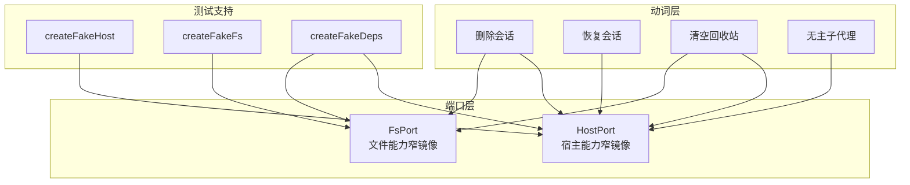
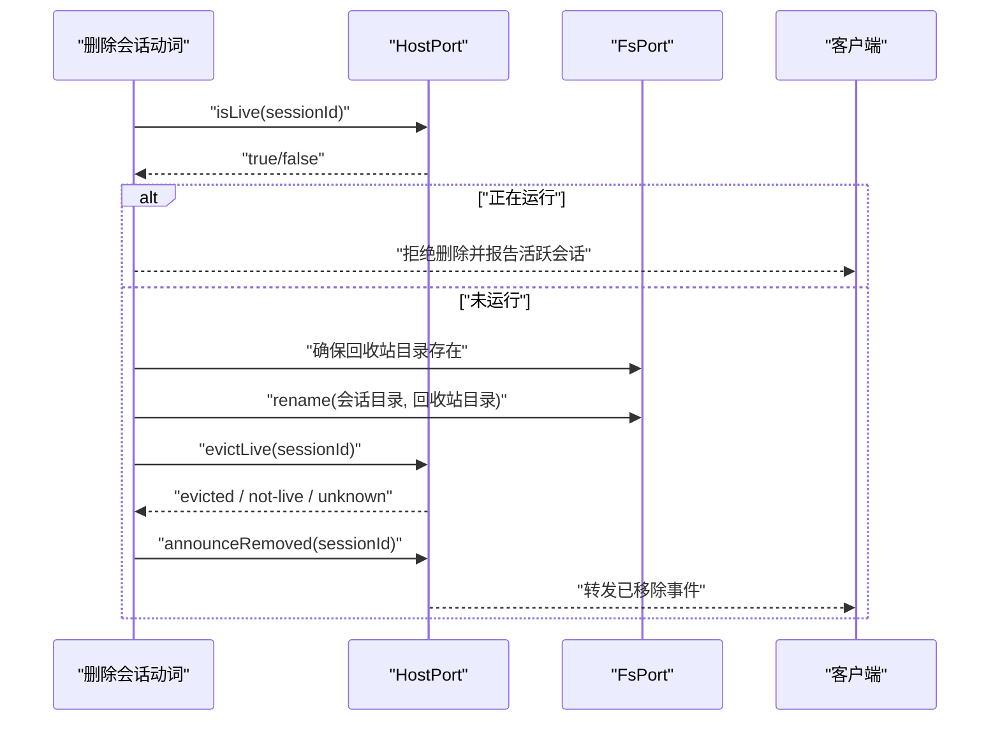
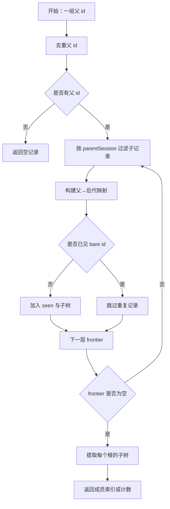
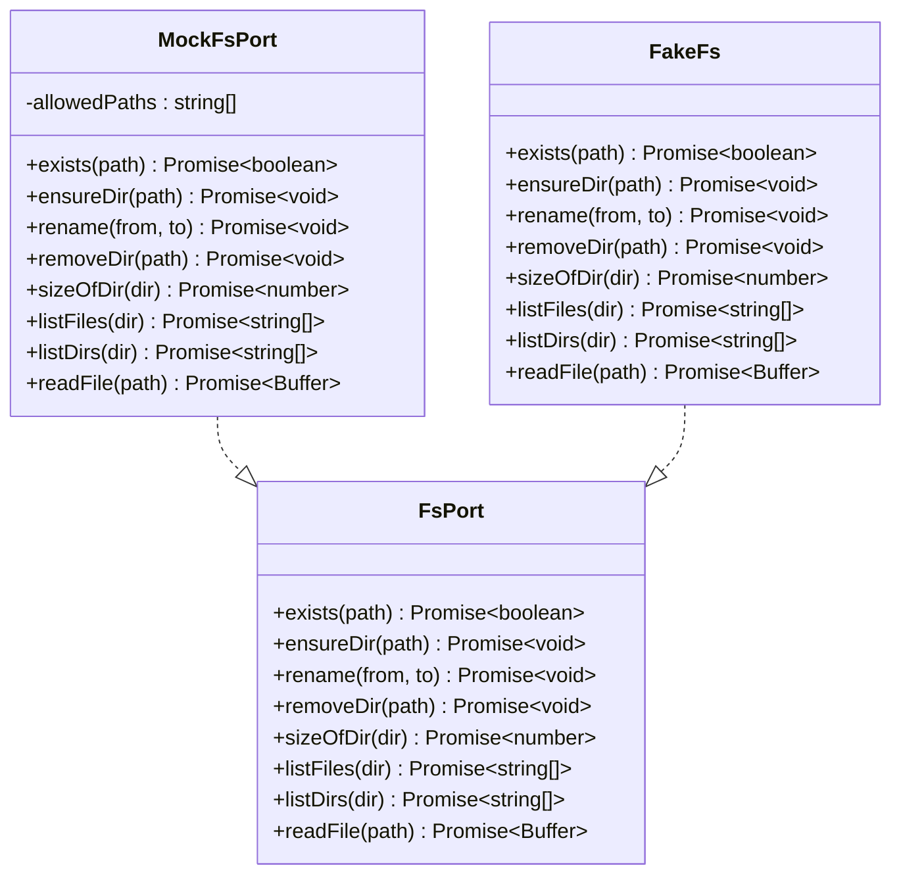
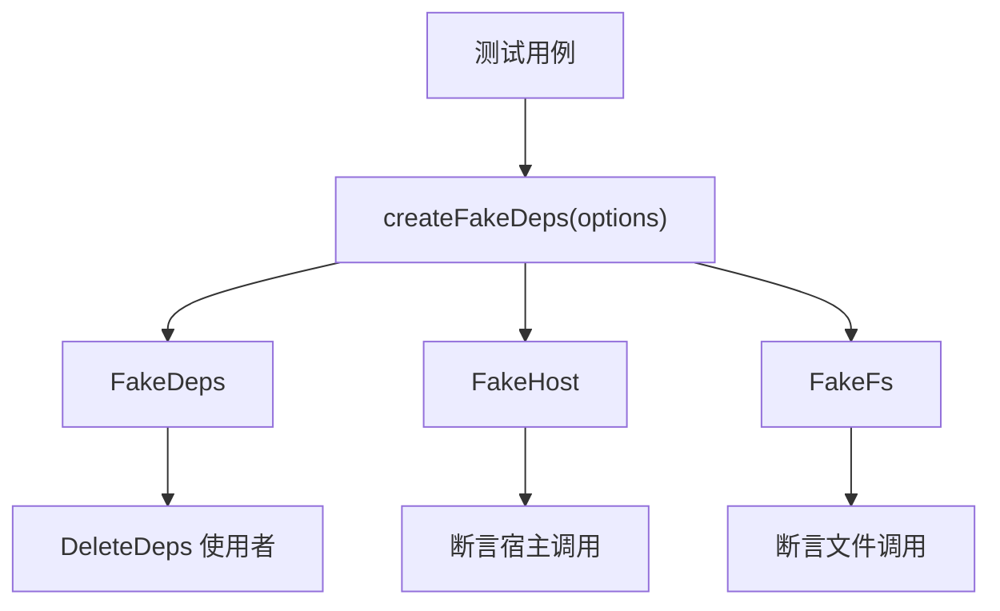
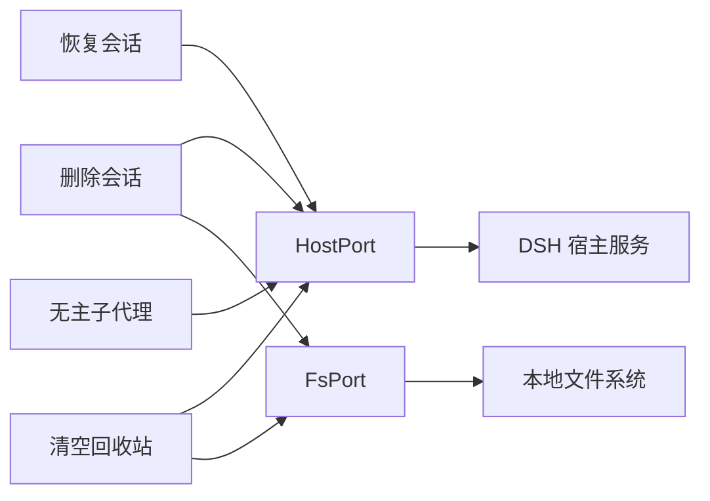

# 端口适配与宿主集成

<cite>
**本文引用的文件**   
- [fs-port.ts](file://src/ports/fs-port.ts)
- [host-port.ts](file://src/ports/host-port.ts)
- [fake-deps.ts](file://tests/support/fake-deps.ts)
- [ports.test.ts](file://tests/ports.test.ts)
- [README.md](file://README.md)
- [package.json](file://package.json)
</cite>

## 目录
1. [引言](#引言)
2. [项目结构中的端口层](#项目结构中的端口层)
3. [设计意图：为什么用端口抽象](#设计意图为什么用端口抽象)
4. [HostPort 契约](#hostport-契约)
5. [FsPort 契约](#fsport-契约)
6. [活跃检查、归档、摘账本与通告流程](#活跃检查归档摘账本与通告流程)
7. [语料与会话子代理查询](#语料与会话子代理查询)
8. [替换实现示例](#替换实现示例)
9. [测试中 fake-deps 的用法](#测试中-fake-deps-的用法)
10. [依赖关系分析](#依赖关系分析)
11. [性能与复杂度](#性能与复杂度)
12. [常见问题排查](#常见问题排查)
13. [结论](#结论)

## 引言
本文聚焦本项目中两个“宿主能力窄镜像”端口：**HostPort** 与 **FsPort**。它们不是完整宿主 API，而是删除会话、恢复、回收站清理等动词（verbs）所真正需要的最小方法集合。通过这一层，代码把第三方宿主差异、真实文件系统调用、内存状态与业务逻辑解耦，从而提升可测试性、可替换性与错误传播的可控性。

## 项目结构中的端口层
端口定义位于 `src/ports` 下；`FsPort` 对应本地文件操作，`HostPort` 对应 DSH 宿主的会话、工作区、归档、活跃性与通告能力。测试侧提供 `createFakeHost`、`createFakeFs`、`createFakeDeps`，用于在不启动宿主、不写盘的情况下验证动词行为。

**图表来源**
- [host-port.ts:1-200](file://src/ports/host-port.ts#L1-L200)
- [fs-port.ts](file://src/ports/fs-port.ts)
- [fake-deps.ts:1-213](file://tests/support/fake-deps.ts#L1-L213)

**章节来源**
- [host-port.ts:1-200](file://src/ports/host-port.ts#L1-L200)
- [fs-port.ts](file://src/ports/fs-port.ts)
- [fake-deps.ts:1-213](file://tests/support/fake-deps.ts#L1-L213)

## 设计意图：为什么用端口抽象
1. **隔离第三方宿主差异**  
   `HostPort` 只声明删除与恢复流程真正调用的成员，例如 `workspaceOf`、`projectDirOf`、`isLive`、`archive`、`unarchive`、`attach`、`detach`、`listSessions`、`subagentMembers` 等。它不 import 宿主类型包，也不做 `declare module`，而是以注释引用 asar 源码片段作为契约依据。这避免插件被宿主内部类型耦合。

2. **提升可测试性**  
   测试不需要启动真实 DSH 宿主或操作磁盘，只需传入 `createFakeHost` / `createFakeFs` 构造的对象。`FakeHost` 和 `FakeFs` 的方法全部是 `vi.fn`，用例可以直接断言参数、返回值和调用顺序。

3. **便于 mock**  
   `FakeDeps` 直接满足 `DeleteDeps` 的形状，但把 `fs` 与 `host` 暴露为假对象。这样测试既可以用 `d.host.isLive(...)` 表达语义，又无需 `as never` 强转——文档明确强调“打洞意味着接口没被验证”，而这里正是用假件验证接口形状。

4. **错误传播清晰**  
   端口实现通常原样抛出底层异常；上层动词层再把它映射到业务错误码（如 `not-found`、`io`）。端口不替宿主兜住所有错误，也不把业务语义包装成原始错误。

**章节来源**
- [host-port.ts:1-200](file://src/ports/host-port.ts#L1-L200)
- [fake-deps.ts:1-213](file://tests/support/fake-deps.ts#L1-L213)

## HostPort 契约
`HostPort` 是宿主服务的窄镜像，包含会话身份、工作区、活跃性、归档、挂接、会话列表、子代理后代以及客户端通告等方法。

| 方法 | 参数 | 返回值 | 语义与错误约定 |
|---|---|---|---|
| `workspaceOf(sessionId)` | 会话 id | `Promise<string | undefined>` | 返回该会话在工作区账本中的 id；不存在时返回 `undefined`。 |
| `workspaceExists(workspaceId)` | 工作区 id | `Promise<boolean>` | 只读判别是否仍在工作区注册表里；不抛错。 |
| `projectDirOf(sessionId)` | 会话 id | `Promise<string | undefined>` | 返回 `<sessions>/<projectKey(cwd)>`；会话不在账本时返回 `undefined`。未知会话按消息匹配吞掉，其他存储故障原样抛。 |
| `titleOf(sessionId)` | 会话 id | `Promise<string>` | 尽力取标题；失败或无值回空串，绝不因标题缺失让删除失败。 |
| `isLive(sessionId)` | 会话 id | `Promise<boolean>` | 调用宿主 waterfall `workspace/session-activity`，非空表示有活动。 |
| `isArchived(sessionId)` | 会话 id | `Promise<boolean>` | 查全局归档集。 |
| `evictLive(sessionId)` | 会话 id | `Promise<EvictionOutcome>` | 从宿主内存 live store 摘除活体；返回 `evicted`、`not-live` 或 `unknown`。任何摘除步骤出错都返回 `unknown`，不抛错。 |
| `announceRemoved(sessionId)` | 会话 id | `Promise<void>` | 转发 `api-session/removed`，让客户端删行。 |
| `announceRestored(sessionId)` | 会话 id | `Promise<void>` | 单条恢复后补发 `api-session/added`；摘要取不到就不发。 |
| `restoredSummariesOf()` | 无 | `Promise<readonly { sessionId; summary }[]>` | 批量恢复前预取宿主会话表；服务不可用时回空数组，不抛。 |
| `announceRestoredBatch(ids, known?)` | 要恢复的 id 列表、可选已知摘要 | `Promise<void>` | 整批通告；若传 `known` 则不再拉表，避免 N 条恢复触发 N 次全表扫描。 |
| `unarchive(sessionId)` | 会话 id | `Promise<void>` | 取消归档。 |
| `detach(sessionId, workspaceId)` | 会话 id、工作区 id | `Promise<void>` | 从工作区 detach。 |
| `attach(sessionId, workspaceId)` | 会话 id、工作区 id | `Promise<void>` | 挂入工作区；找不到工作区抛 `workspace not found` 开头错误。 |
| `archive(sessionId, workspaceId?)` | 会话 id、可选工作区 id | `Promise<void>` | 全局归档，与工作区无关；workspaceId 只是调用点对称参数。 |
| `listSessions()` | 无 | `Promise<readonly SessionIdentity[] \| undefined>` | 整个会话语料的只读身份表；服务缺席返回 `undefined`，不是空数组。 |
| `subagentMembersBatch(parentIds)` | 父会话 id 列表 | `Promise<Record<string, readonly SubagentMember[]>>` | BFS 点出多个父的全部后代；服务缺省回 `{}`。 |
| `subagentCounts(parentIds)` | 父会话 id 列表 | `Promise<Record<string, number>>` | 数后代条数；没有后代的不出现在结果中；服务缺省回 `{}`。 |
| `subagentMembers(sessionId)` | 父会话 id | `Promise<readonly SubagentMember[]>` | 列出该父在盘上的后代；服务没挂回 `[]`。 |

`EvictionOutcome` 只有三种值：
- `evicted`：已从宿主内存摘掉。
- `not-live`：本来就没有活体。
- `unknown`：读不到 live store、旧版宿主或摘除过程出错，不能据此通告客户端。

**章节来源**
- [host-port.ts:1-200](file://src/ports/host-port.ts#L1-L200)
- [host-port.ts:201-508](file://src/ports/host-port.ts#L201-L508)

## FsPort 契约
`FsPort` 是文件系统的窄镜像，主要服务于回收站目录、会话日志、正文与占用大小计算。

| 方法 | 参数 | 返回值 | 语义与错误约定 |
|---|---|---|---|
| `exists(path)` | 路径 | `Promise<boolean>` | 判断文件或目录是否存在；对不存在路径返回 `false`，不抛错。 |
| `ensureDir(path)` | 路径 | `Promise<void>` | 递归创建目录，常用于首次建立回收站会话目录。 |
| `rename(from, to)` | 源路径、目标路径 | `Promise<void>` | 同卷重命名，用作原子移动。 |
| `removeDir(path)` | 路径 | `Promise<void>` | 删除回收站中的会话目录。 |
| `sizeOfDir(dir)` | 目录路径 | `Promise<number>` | 递归累加目录内所有文件的字节数。 |
| `listFiles(dir)` | 目录路径 | `Promise<string[]>` | 列出单层文件名与子目录名，不递归。 |
| `listDirs(dir)` | 目录路径 | `Promise<string[]>` | 列出子目录名，不递归。 |
| `readFile(path)` | 路径 | `Promise<Buffer>` | 读取文件字节；回收站详情需要用它读 session 正文。 |

关键测试断言包括：
- `exists('C:/definitely/not/here')` 返回 `false`。
- `sizeOfDir` 对多层子目录的文件进行字节累加。
- `sizeOfDir` 解构调用也能工作，不依赖 `this` 绑定。
- `ensureDir` 能创建多级回收站目录。
- `listFiles` 只列一层；`readFile` 返回 Buffer。

**章节来源**
- [fs-port.ts](file://src/ports/fs-port.ts)
- [ports.test.ts:1-54](file://tests/ports.test.ts#L1-L54)

## 活跃检查、归档、摘账本与通告流程
删除会话的典型路径是：先问宿主“是否在跑”，再决定是否继续；成功持久化到回收站后，尝试摘除内存中的活体并通告客户端。

**图表来源**
- [host-port.ts:1-200](file://src/ports/host-port.ts#L1-L200)
- [fs-port.ts](file://src/ports/fs-port.ts)

### 活跃检查
`isLive` 使用宿主 waterfall `workspace/session-activity`，与官方归档准入同源。如果返回非空活动列表，就认为会话在运行。

### 摘除活体
`evictLive` 走宿主内部 live store，因为仅搬文件无法清除内存中仍在列表里的会话。它必须返回三态：
- `evicted`：摘成功。
- `not-live`：内存中没有。
- `unknown`：live store 不可用、形状不符或 detach 失败。

`unknown` 不会让删除持久化部分失败，也不会冒然通告客户端“已移除”，因为此时无法保证宿主列表干净。

### 通告
- `announceRemoved` 发送 `api-session/removed`，让客户端当场删行。
- `announceRestored` / `announceRestoredBatch` 在恢复时使用，前者单条，后者批量并支持传入预取摘要。

**章节来源**
- [host-port.ts:1-200](file://src/ports/host-port.ts#L1-L200)
- [host-port.ts:201-508](file://src/ports/host-port.ts#L201-L508)

## 语料与会话子代理查询
`listSessions` 返回整个会话语料的只读身份表，包括 `sessionId`、可选 `parentSessionId`、`projectDir` 与 `subagent` 标记。它是“live ∪ persisted”视图；当宿主服务缺席时返回 `undefined`，调用方必须把这种缺席视为失败，而不能当成“没有会话”。

子代理查询有三条相关方法：
- `subagentMembers(parentId)`：列出某个父在盘上的后代。
- `subagentMembersBatch(parentIds)`：一次 BFS 查出多个父的后代。
- `subagentCounts(parentIds)`：给出每个父的后代数。

内部使用 `descendantsByParent` 逐层查询，避免依赖可能漏掉回收站目标的 `traceSession`；同时用 `seen` 去重，防止环导致无限遍历。

**图表来源**
- [host-port.ts:201-508](file://src/ports/host-port.ts#L201-L508)

**章节来源**
- [host-port.ts:201-508](file://src/ports/host-port.ts#L201-L508)

## 替换实现示例
由于端口是方法集合而不是类，替换实现通常是一个函数返回对象字面量。以下示例展示如何写出一个“只允许特定路径”的 `FsPort` 替换实现。

**图表来源**
- [fs-port.ts](file://src/ports/fs-port.ts)
- [fake-deps.ts:1-213](file://tests/support/fake-deps.ts#L1-L213)

生产端替换通常是 `createHostPort(ctx)` 与 `createFsPort()`；测试端替换则是 `createFakeHost(options)`、`createFakeFs(options)` 或直接构造满足 `HostPort` / `FsPort` 类型的对象。

## 测试中 fake-deps 的用法
`tests/support/fake-deps.ts` 提供三类工具：

1. `createFakeHost(options)`  
   返回 `FakeHost`，即 `HostPort` 的 `vi.fn` 版本。默认行为是“最安静的成功”：
   - `workspaceExists` 默认 `true`。
   - `isLive` 默认 `false`。
   - `isArchived` 默认 `false`。
   - `members`、`counts`、`corpus`、`summaries` 等字段声明式控制世界状态。
   - 可选 `logMethods` 只记录指定方法的调用，读口默认不写日志。

2. `createFakeFs(options)`  
   返回 `FakeFs`，即 `FsPort` 的 `vi.fn` 版本。默认行为是“目录都在、字节可量、不真动盘”：
   - `exists` 默认 `true`。
   - `sizeOfDir` 默认返回固定值。
   - `listFiles` 默认空数组。
   - `listDirs` 可按路径动态返回。
   - `readFile` 未配置时抛出带路径的错误，提示测试准备数据。

3. `createFakeDeps(over)`  
   一次性装配出 `DeleteDeps` 形状的依赖对象，并把 `host` 与 `fs` 暴露为可断言的假对象。它的目标是：
   - 测试不必自己拼凑端口对象字面量。
   - 避免 `as never` 强转。
   - 用假件验证接口形状，而不是让编译器闭嘴。
   - 共享一条跨端口的调用日志，方便断言“fs 的 rename 排在 host 的 archive 之后”这类顺序。

**图表来源**
- [fake-deps.ts:1-213](file://tests/support/fake-deps.ts#L1-L213)

**章节来源**
- [fake-deps.ts:1-213](file://tests/support/fake-deps.ts#L1-L213)

## 依赖关系分析
端口层向上被删除、恢复、清空回收站和无主子代理等动词使用；向下分别对接 DSH 宿主服务和本地文件系统。

**图表来源**
- [host-port.ts:1-200](file://src/ports/host-port.ts#L1-L200)
- [fs-port.ts](file://src/ports/fs-port.ts)

**章节来源**
- [host-port.ts:1-200](file://src/ports/host-port.ts#L1-L200)
- [fs-port.ts](file://src/ports/fs-port.ts)

## 性能与复杂度
- `descendantsByParent` 按层 BFS，时间复杂度主要取决于“层数 × 每层查询结果数量”；每条记录通过 `seen` 去重，因此即使出现环也不会无限循环，只会得到少数重复保护下的结果。
- `announceRestoredBatch` 支持传入 `known` 摘要表，避免批量恢复时每条都拉一次宿主会话表。文档明确指出：100 条恢复若各自拉表，就是 100 遍全表扫描，这是历史性能问题的重要来源。
- `subagentMembersBatch` 一次 BFS 替代多次单独查询，减少宿主调用次数。
- `sizeOfDir` 递归遍历目录；对于大型回收站会话，应关注其累计开销。

**章节来源**
- [host-port.ts:201-508](file://src/ports/host-port.ts#L201-L508)

## 常见问题排查

### 文件权限不足
**现象**  
`FsPort` 调用 `ensureDir`、`rename`、`removeDir`、`readFile` 时抛出 IO 错误。

**排查要点**
1. 确认回收站目录 `~/.dsh/session-trash` 所在分区可读写。
2. 确认当前用户对该目录及会话目录有写入权限。
3. 注意 `rename` 是同卷原子移动；跨卷移动通常退化为复制+删除，可能带来额外 IO 风险。
4. 测试中可用 `createFakeFs({ exists: false, size: 0 })` 模拟路径不存在或容量异常，验证错误分支。

**章节来源**
- [fs-port.ts](file://src/ports/fs-port.ts)
- [ports.test.ts:1-54](file://tests/ports.test.ts#L1-L54)
- [README.md](file://README.md)

### 宿主服务不可用
**现象**  
侧栏没有“回收站”，会话菜单也没有“删除”；插件激活通道探测不过时，入口不注册。

**排查要点**
1. 重启宿主；Node 半不走 HMR，修改 Node 端后必须重启。
2. 确认宿主版本满足 `engines.dsh` 区间。
3. 确认宿主兼容性清单中有对应版本。
4. 端口层对 `listSessions`、`restoredSummariesOf`、投影缓存等服务采用“缺席回空或不抛”的降级策略，但调用方仍需把某些 `undefined` 当作失败处理。

**章节来源**
- [README.md](file://README.md)
- [package.json:1-105](file://package.json#L1-L105)
- [host-port.ts:1-200](file://src/ports/host-port.ts#L1-L200)

### 删除后列表行仍在
**原因**  
会话列表是“持久化 ∪ 内存活体”。搬文件只清持久化一侧；内存中的活体还在，所以列表仍显示。

**处理**
1. `evictLive` 尝试摘除活体；成功返回 `evicted`。
2. 若返回 `unknown`，不冒然通告，因为无法断言宿主列表干净。
3. 冷会话走正常路径；本机运行期打开过的会话需要摘活体。
4. 必要时刷新页面，让客户端重连或重新拉表。

**章节来源**
- [host-port.ts:1-200](file://src/ports/host-port.ts#L1-L200)
- [README.md](file://README.md)

### 工作区已被删除时的恢复
**现象**  
恢复时报 `workspace not found`。

**处理**
1. `workspaceExists` 先判断工作区是否仍存在。
2. 若不存在，跳过 `attach`，照常回盘并归入“未分组”。
3. `isWorkspaceMissingError` 用来区分“工作区缺失”和真正的 IO 故障，避免静默改变归属。

**章节来源**
- [host-port.ts:1-200](file://src/ports/host-port.ts#L1-L200)
- [host-port.ts:201-508](file://src/ports/host-port.ts#L201-L508)

### 测试断言失败或类型强转过多
**症状**
- 测试里大量使用 `as never` 或 `as any`。
- 假对象缺少方法，运行时才报错。
- 无法断言调用顺序或参数。

**修复**
1. 使用 `createFakeHost` / `createFakeFs`。
2. 使用 `createFakeDeps` 装配 `DeleteDeps`。
3. 用 `logMethods` 控制日志范围，避免读口污染日志。
4. 直接断言 `vi.fn` 的参数与返回值，而不是绕过类型系统。

**章节来源**
- [fake-deps.ts:1-213](file://tests/support/fake-deps.ts#L1-L213)

## 结论
HostPort 与 FsPort 是本项目的关键适配边界：它们把 DSH 宿主差异和本地文件系统调用收敛为一组可测试、可替换、错误传播可控的窄接口。HostPort 负责会话身份、工作区、活跃性、归档、挂接、语料与子代理查询；FsPort 负责回收站目录、正文读取与占用统计。配合 `createFakeHost`、`createFakeFs` 与 `createFakeDeps`，测试可以以声明式方式描述世界状态，而不必启动宿主或写盘。

在实践中，维护这两个端口的原则是：
- 新增宿主能力时，先在端口上声明最小方法，再让动词消费。
- 不要为了兼容宿主类型而引入宿主包依赖。
- 对“可选服务”采用 `ctx.get` 式弱访问，缺席时按设计语义降级。
- 对 IO 错误保持原样抛出，由上层映射为业务错误码。
- 用假件验证接口形状，而不是用强转掩盖接口不完整。