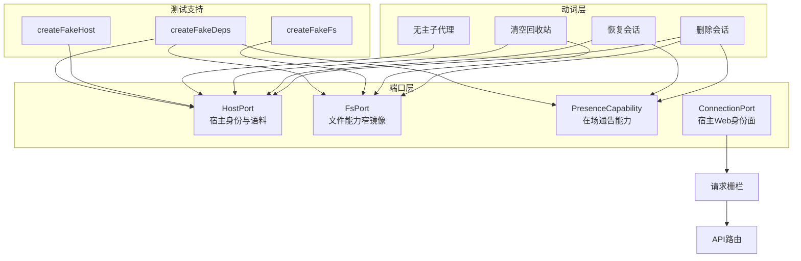
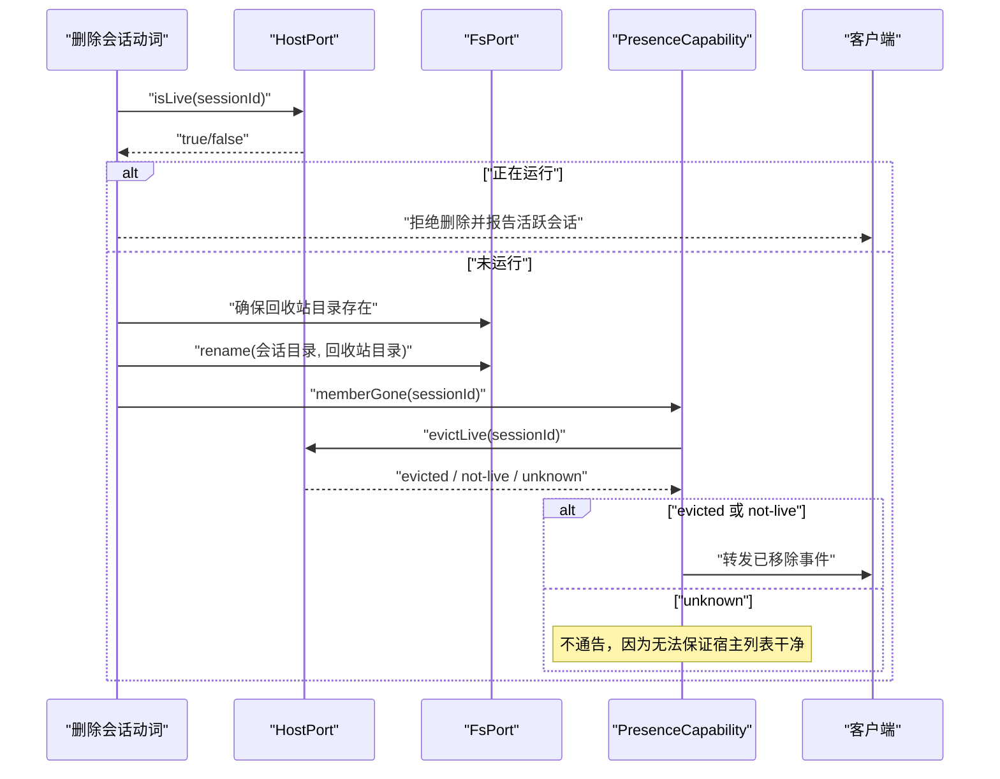
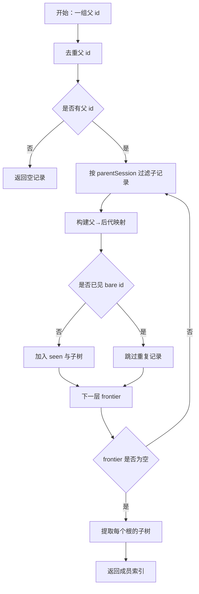
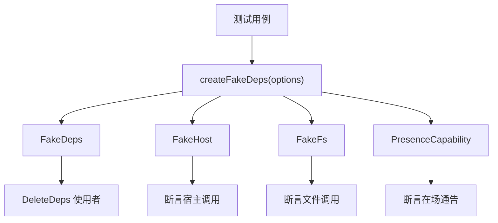
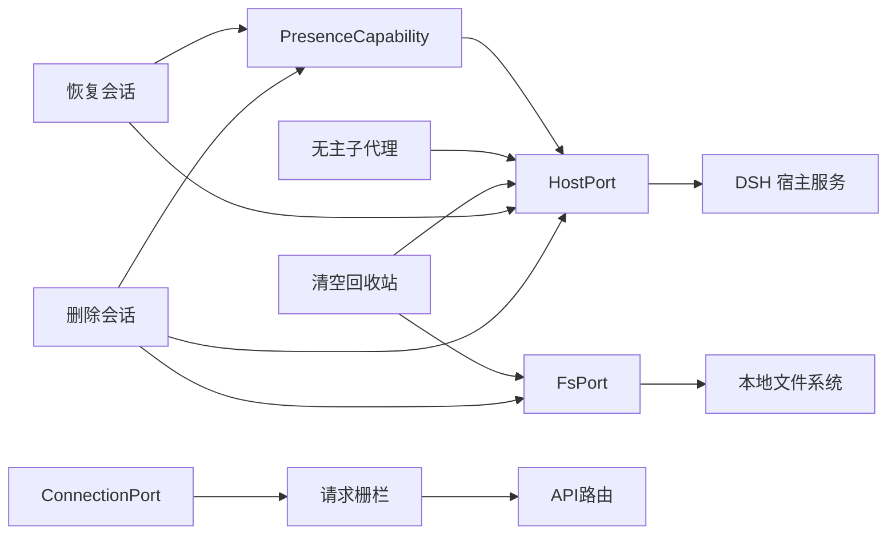

# 端口适配与宿主集成

<cite>
**本文引用的文件**   
- [fs-port.ts](file://src/ports/fs-port.ts)
- [host-port.ts](file://src/ports/host-port.ts)
- [presence-port.ts](file://src/ports/presence-port.ts)
- [connection-port.ts](file://src/ports/connection-port.ts)
- [fake-deps.ts](file://tests/support/fake-deps.ts)
- [ports.test.ts](file://tests/ports.test.ts)
- [deps.ts](file://src/deps.ts)
- [member-presence.ts](file://src/verbs/member-presence.ts)
- [request-trust.ts](file://src/api/request-trust.ts)
- [README.md](file://README.md)
- [package.json](file://package.json)
</cite>

## 目录
1. [引言](#引言)
2. [项目结构中的端口层](#项目结构中的端口层)
3. [设计意图：为什么用端口抽象](#设计意图为什么用端口抽象)
4. [HostPort 契约](#hostport-契约)
5. [FsPort 契约](#fsport-契约)
6. [PresenceCapability 独立端口](#presencecapability-独立端口)
7. [ConnectionPort 窄镜像](#connectionport-窄镜像)
8. [活跃检查、归档、摘账本与通告流程](#活跃检查归档摘账本与通告流程)
9. [语料与会话子代理查询](#语料与会话子代理查询)
10. [替换实现示例](#替换实现示例)
11. [测试中 fake-deps 的用法](#测试中-fake-deps-的用法)
12. [依赖关系分析](#依赖关系分析)
13. [性能与复杂度](#性能与复杂度)
14. [常见问题排查](#常见问题排查)
15. [结论](#结论)

## 引言
本文聚焦本项目中四个"宿主能力窄镜像"端口：**HostPort**、**FsPort**、**PresenceCapability** 与 **ConnectionPort**。它们不是完整宿主 API，而是删除会话、恢复、回收站清理等动词（verbs）所真正需要的最小方法集合。通过这一层，代码把第三方宿主差异、真实文件系统调用、内存状态与业务逻辑解耦，从而提升可测试性、可替换性与错误传播的可控性。

其中，HostPort 按角色切分为身份、语料两片（在场能力已拆出为独立的 PresenceCapability 端口），FsPort 新增 `statFile` 与 `removeFile` 用于附件读写与清理，ConnectionPort 提供宿主 Web 身份面用于请求栅栏的远程支。

## 项目结构中的端口层
端口定义位于 `src/ports` 下；`FsPort` 对应本地文件操作，`HostPort` 对应 DSH 宿主的会话、工作区、归档、活跃性与语料能力，`PresenceCapability` 负责成员离场与归位通告，`ConnectionPort` 负责宿主 Web 身份验证。测试侧提供 `createFakeHost`、`createFakeFs`、`createFakeDeps`，用于在不启动宿主、不写盘的情况下验证动词行为。



**图表来源**
- [host-port.ts:1-84](file://src/ports/host-port.ts#L1-L84)
- [fs-port.ts](file://src/ports/fs-port.ts)
- [presence-port.ts](file://src/ports/presence-port.ts)
- [connection-port.ts](file://src/ports/connection-port.ts)
- [fake-deps.ts:1-270](file://tests/support/fake-deps.ts#L1-L270)

**章节来源**
- [host-port.ts:1-84](file://src/ports/host-port.ts#L1-L84)
- [fs-port.ts](file://src/ports/fs-port.ts)
- [presence-port.ts](file://src/ports/presence-port.ts)
- [connection-port.ts](file://src/ports/connection-port.ts)
- [fake-deps.ts:1-270](file://tests/support/fake-deps.ts#L1-L270)

## 设计意图：为什么用端口抽象
1. **隔离第三方宿主差异**  
   `HostPort` 只声明删除与恢复流程真正调用的成员，例如 `workspaceOf`、`projectDirOf`、`isLive`、`archive`、`unarchive`、`attach`、`detach`、`listSessions`、`subagentMembersOf` 等。它不 import 宿主类型包，也不做 `declare module`，而是以注释引用 asar 源码片段作为契约依据。这避免插件被宿主内部类型耦合。

2. **提升可测试性**  
   测试不需要启动真实 DSH 宿主或操作磁盘，只需传入 `createFakeHost` / `createFakeFs` 构造的对象。`FakeHost` 和 `FakeFs` 的方法全部是 `vi.fn`，用例可以直接断言参数、返回值和调用顺序。

3. **便于 mock**  
   `FakeDeps` 直接满足 `DeleteDeps` 的形状，但把 `fs` 与 `host` 暴露为假对象。这样测试既可以用 `d.host.isLive(...)` 表达语义，又无需 `as never` 强转——文档明确强调"打洞意味着接口没被验证"，而这里正是用假件验证接口形状。

4. **错误传播清晰**  
   端口实现通常原样抛出底层异常；上层动词层再把它映射到业务错误码（如 `not-found`、`io`）。端口不替宿主兜住所有错误，也不把业务语义包装成原始错误。

5. **危险能力收口**  
   `CoreDeps.fs` 不含 `removeDir` / `removeFile`，`CoreDeps.host` 不含在场三件（`evictLive`、`announceRemoved`、`announceRestored`）——两条危险能力各走 `RemovalDeps` 与 `CoreDeps.presence`。这样"谁可以删文件、谁可以摘活体"由依赖面回答，而不是靠源码扫描维持。

6. **请求栅栏的远程支**  
   `ConnectionPort` 提供宿主 Web 身份面，用于 LAN / 反代部署时的远程客户端认证。每次请求惰性解析服务，缺席时 fail-closed（退回只有本机可访问的状态）。

**章节来源**
- [host-port.ts:1-84](file://src/ports/host-port.ts#L1-L84)
- [fs-port.ts](file://src/ports/fs-port.ts)
- [presence-port.ts](file://src/ports/presence-port.ts)
- [connection-port.ts](file://src/ports/connection-port.ts)
- [fake-deps.ts:1-270](file://tests/support/fake-deps.ts#L1-L270)
- [deps.ts](file://src/deps.ts)

## HostPort 契约
`HostPort` 是宿主服务的窄镜像，包含会话身份、工作区、活跃性、归档、挂接、会话列表、子代理后代等方法。**注意**：在场通告能力（`evictLive`、`announceRemoved`、`announceRestored`）已从 `HostPort` 拆出为独立的 `PresenceCapability` 端口（ADR-0019），动词不再直接从 `HostPort` 调用这些方法。

| 方法 | 参数 | 返回值 | 语义与错误约定 |
|---|---|---|---|
| `workspaceOf(sessionId)` | 会话 id | `Promise<string \| undefined>` | 返回该会话在工作区账本中的 id；不存在时返回 `undefined`。 |
| `workspaceExists(workspaceId)` | 工作区 id | `Promise<boolean>` | 只读判别是否仍在工作区注册表里；不抛错。 |
| `projectDirOf(sessionId)` | 会话 id | `Promise<string \| undefined>` | 返回 `<sessions>/<projectKey(cwd)>`；会话不在账本时返回 `undefined`。未知会话按消息匹配吞掉，其他存储故障原样抛。 |
| `titleOf(sessionId)` | 会话 id | `Promise<string>` | 尽力取标题；失败或无值回空串，绝不因标题缺失让删除失败。 |
| `isLive(sessionId)` | 会话 id | `Promise<boolean>` | 调用宿主 waterfall `workspace/session-activity`，非空表示有活动。 |
| `isArchived(sessionId)` | 会话 id | `Promise<boolean>` | 查全局归档集。 |
| `unarchive(sessionId)` | 会话 id | `Promise<void>` | 取消归档。 |
| `detach(sessionId, workspaceId)` | 会话 id、工作区 id | `Promise<void>` | 从工作区 detach。 |
| `attach(sessionId, workspaceId)` | 会话 id、工作区 id | `Promise<void>` | 挂入工作区；找不到工作区抛 `workspace not found` 开头错误。 |
| `archive(sessionId, workspaceId?)` | 会话 id、可选工作区 id | `Promise<void>` | 全局归档，与工作区无关；workspaceId 只是调用点对称参数。 |
| `listSessions()` | 无 | `Promise<CorpusRead<readonly SessionIdentity[]>>` | 整个会话语料的只读身份表；服务缺席返回 `{ available: false }`，不是空数组。 |
| `subagentMembersOf(parentIds)` | 父会话 id 列表 | `Promise<CorpusRead<Record<string, readonly SubagentMember[]>>>` | BFS 点出多个父的全部后代；服务缺省回 `{ available: true, value: {} }`。 |

`CorpusRead<T>` 有两种形态：
- `{ available: true; value: T }`：看见了语料，值为具体数据。
- `{ available: false }`：这一趟看不见语料（服务没挂或方法缺席），与"看见了、里面是空的"是两件事。

**章节来源**
- [host-port.ts:1-84](file://src/ports/host-port.ts#L1-L84)
- [host-port.ts:201-563](file://src/ports/host-port.ts#L201-L563)

## FsPort 契约
`FsPort` 是文件系统的窄镜像，主要服务于回收站目录、会话日志、正文、占用大小计算以及附件读写与清理。

| 方法 | 参数 | 返回值 | 语义与错误约定 |
|---|---|---|---|
| `exists(path)` | 路径 | `Promise<boolean>` | 判断文件或目录是否存在；对不存在路径返回 `false`，不抛错。 |
| `ensureDir(path)` | 路径 | `Promise<void>` | 递归创建目录，常用于首次建立回收站会话目录。 |
| `rename(from, to)` | 源路径、目标路径 | `Promise<void>` | 同卷重命名，用作原子移动。目标已存在一律失败，跨卷（EXDEV）也失败并说清楚。 |
| `removeDir(path)` | 路径 | `Promise<void>` | 删除回收站中的会话目录。危险能力，只挂在 `RemovalDeps` 上。 |
| `sizeOfDir(dir)` | 目录路径 | `Promise<number>` | 递归累加目录内所有文件的字节数。 |
| `listFiles(dir)` | 目录路径 | `Promise<string[]>` | 列出单层文件名与子目录名，不递归。 |
| `listDirs(dir)` | 目录路径 | `Promise<string[]>` | 列出子目录名，不递归；跟随指向目录的软链。 |
| `readFile(path)` | 路径 | `Promise<Buffer>` | 读取文件字节；回收站详情需要用它读 session 正文。 |
| `realpath(path)` | 路径 | `Promise<string>` | 解析符号链接后的真实路径。递归走目录时防环用。 |
| `statFile(path)` | 路径 | `Promise<{ size: number }>` | 只读的单文件读数：附件渲染与独占计划都用它（不递归、不跟随目录）。 |
| `removeFile(path)` | 路径 | `Promise<void>` | 删单个文件（不是目录）。危险能力，只挂在 `RemovalDeps` 上。 |

关键测试断言包括：
- `exists('C:/definitely/not/here')` 返回 `false`。
- `sizeOfDir` 对多层子目录的文件进行字节累加。
- `sizeOfDir` 解构调用也能工作，不依赖 `this` 绑定。
- `ensureDir` 能创建多级回收站目录。
- `listFiles` 只列一层；`readFile` 返回 Buffer。
- `listDirs` 跟随指向目录的软链；指向文件与断链都不算目录。
- `rename` 搬目录；目标已存在就拒绝——Linux 会静默替代空目录，两个平台必须一个语义。
- `statFile` 量文件、`removeFile` 幂等删除，且方法能解构出来单独调。

**章节来源**
- [fs-port.ts](file://src/ports/fs-port.ts)
- [ports.test.ts:1-124](file://tests/ports.test.ts#L1-L124)

## PresenceCapability 独立端口
`PresenceCapability` 是从 `HostPort` 拆出的独立端口，负责成员在场通告能力（ADR-0019）。动词不再直接从 `HostPort` 调用 `evictLive` / `announce*`，而是通过 `CoreDeps.presence` 访问这个能力面。

| 方法 | 参数 | 返回值 | 语义与错误约定 |
|---|---|---|---|
| `memberGone(sessionId, facts?)` | 会话 id、可选事实 | `Promise<void>` | 成员已经不在宿主可见列表：摘活体；三态不是 unknown 时发 removed。`backInTrash: false` 表示目录没退回回收站（恢复回滚失败），此时什么都不做。 |
| `memberBack(sessionId, facts)` | 会话 id、事实 | `Promise<void>` | 成员已经回到原来的可见状态：目录与账本两件写都回去才发 added。 |
| `announceRestored(ids)` | 要恢复的 id 列表 | `Promise<void>` | 批量恢复的"回来了"通告；单条就是长度为 1 的批。 |

`MemberBackFacts` 结构：
```typescript
interface MemberBackFacts {
  readonly diskBack: boolean      // 目录已退回会话目录
  readonly workspaceBack: boolean // 工作区账本已恢复
}
```

生产实现住 `src/verbs/member-presence.ts`；组合根装配一次，挂在 `CoreDeps.presence`。这样"谁可以摘活体、谁可以发通告"由依赖面回答，而不是靠源码扫描维持。

**章节来源**
- [presence-port.ts](file://src/ports/presence-port.ts)
- [member-presence.ts](file://src/verbs/member-presence.ts)
- [deps.ts](file://src/deps.ts)

## ConnectionPort 窄镜像
`ConnectionPort` 是宿主 `connection` 服务（`dsh-client-connection` 的 `HostConnectionService`）的窄镜像，用于请求栅栏的远程支（ADR-0022）。它提供宿主 Web 身份面，让 LAN / 反代部署的远程客户端能够过宿主的认证。

| 方法 | 参数 | 返回值 | 语义与错误约定 |
|---|---|---|---|
| `verdictFor(req)` | HTTP 请求 | `ConnectionVerdict` | 一次做宿主 `/api` 的那两道——Host/Origin 栅栏与"已认证 live peer"。 |

`ConnectionVerdict` 有四种形态：
- `{ kind: 'allowed' }`：允许通过。
- `{ kind: 'absent' }`：组成里没有这个服务（无 web 组成 / 老代次）——调用方 fail-closed。
- `{ kind: 'unauthenticated' }`：宿主认可归属，但这条请求没带已认证身份（401）。
- `{ kind: 'untrusted' }`：宿主不认可归属（Host/Origin 栅栏不过，或它给出的其余状态码）。

**关键设计决策**：
1. **每次请求惰性解析服务**：不在激活时取一次。插件与 `client-connection` 的激活顺序没有承诺，取早了会让远程支永远缺席（LAN 上全 403 且难排查）。`ctx.get` 是同步查表，代价可以忽略。
2. **状态码在这里翻成裁决**：401 = 归属对、缺身份；403 = 归属不对；其余按归属不对处理。调用方拿到的就是自己的词表，不需要知道宿主用哪个码表达哪件事。
3. **成员抛错按"归属不对"拒绝**（fail-closed）：确保在无法确定身份时采取保守策略。

**章节来源**
- [connection-port.ts](file://src/ports/connection-port.ts)
- [request-trust.ts](file://src/api/request-trust.ts)

## 活跃检查、归档、摘账本与通告流程
删除会话的典型路径是：先问宿主"是否在跑"，再决定是否继续；成功持久化到回收站后，尝试摘除内存中的活体并通告客户端。



**图表来源**
- [host-port.ts:1-84](file://src/ports/host-port.ts#L1-L84)
- [fs-port.ts](file://src/ports/fs-port.ts)
- [presence-port.ts](file://src/ports/presence-port.ts)

### 活跃检查
`isLive` 使用宿主 waterfall `workspace/session-activity`，与官方归档准入同源。如果返回非空活动列表，就认为会话在运行。

### 摘除活体
`evictLive` 走宿主内部 live store，因为仅搬文件无法清除内存中仍在列表里的会话。它必须返回三态：
- `evicted`：已从宿主内存摘掉。
- `not-live`：内存中没有。
- `unknown`：live store 不可用、形状不符或摘除过程出错。

`unknown` 不会让删除持久化部分失败，也不会冒然通告客户端"已移除"，因为此时无法保证宿主列表干净。

### 通告
- `memberGone` 发送 `api-session/removed`，让客户端当场删行。
- `memberBack` / `announceRestored` 在恢复时使用，前者单条，后者批量并支持传入预取摘要。

**章节来源**
- [host-port.ts:1-84](file://src/ports/host-port.ts#L1-L84)
- [host-port.ts:201-563](file://src/ports/host-port.ts#L201-L563)
- [presence-port.ts](file://src/ports/presence-port.ts)
- [member-presence.ts](file://src/verbs/member-presence.ts)

## 语料与会话子代理查询
`listSessions` 返回整个会话语料的只读身份表，包括 `sessionId`、可选 `parentSessionId`、`projectDir` 与 `subagent` 标记。它是"live ∪ persisted"视图；当宿主服务缺席时返回 `{ available: false }`，调用方必须把这种缺席视为失败，而不能当成"没有会话"。

子代理查询统一为一条方法：
- `subagentMembersOf(parentIds)`：一次 BFS 查出多个父的后代，返回 `父 → 后代` 的映射。

内部使用 `descendantsByParent` 逐层查询，避免依赖可能漏掉回收站目标的 `traceSession`；同时用 `seen` 去重，防止环导致无限遍历。



**图表来源**
- [host-port.ts:201-563](file://src/ports/host-port.ts#L201-L563)

**章节来源**
- [host-port.ts:201-563](file://src/ports/host-port.ts#L201-L563)

## 替换实现示例
由于端口是方法集合而不是类，替换实现通常是一个函数返回对象字面量。以下示例展示如何写出一个"只允许特定路径"的 `FsPort` 替换实现。

```mermaid
classDiagram
  class FsPort {
    +exists(path) Promise~boolean~
    +ensureDir(path) Promise~void~
    +rename(from, to) Promise~void~
    +removeDir(path) Promise~void~
    +sizeOfDir(dir) Promise~number~
    +listFiles(dir) Promise~string[]~
    +listDirs(dir) Promise~string[]~
    +readFile(path) Promise~Buffer~
    +realpath(path) Promise~string~
    +statFile(path) Promise~{size:number}~
    +removeFile(path) Promise~void~
  }

  class MockFsPort {
    -allowedPaths : string[]
    +exists(path) Promise~boolean~
    +ensureDir(path) Promise~void~
    +rename(from, to) Promise~void~
    +removeDir(path) Promise~void~
    +sizeOfDir(dir) Promise~number~
    +listFiles(dir) Promise~string[]~
    +listDirs(dir) Promise~string[]~
    +readFile(path) Promise~Buffer~
    +realpath(path) Promise~string~
    +statFile(path) Promise~{size:number}~
    +removeFile(path) Promise~void~
  }

  class FakeFs {
    +exists(path) Promise~boolean~
    +ensureDir(path) Promise~void~
    +rename(from, to) Promise~void~
    +removeDir(path) Promise~void~
    +sizeOfDir(dir) Promise~number~
    +listFiles(dir) Promise~string[]~
    +listDirs(dir) Promise~string[]~
    +readFile(path) Promise~Buffer~
    +realpath(path) Promise~string~
    +statFile(path) Promise~{size:number}~
    +removeFile(path) Promise~void~
  }

  MockFsPort ..|> FsPort
  FakeFs ..|> FsPort
```

**图表来源**
- [fs-port.ts](file://src/ports/fs-port.ts)
- [fake-deps.ts:1-270](file://tests/support/fake-deps.ts#L1-L270)

生产端替换通常是 `createHostPort(ctx)` 与 `createFsPort()`；测试端替换则是 `createFakeHost(options)`、`createFakeFs(options)` 或直接构造满足 `HostPort` / `FsPort` 类型的对象。

## 测试中 fake-deps 的用法
`tests/support/fake-deps.ts` 提供三类工具：

1. `createFakeHost(options)`  
   返回 `FakeHost`，即 `HostPort` 的 `vi.fn` 版本。默认行为是"最安静的成功"：
   - `workspaceExists` 默认 `true`。
   - `isLive` 默认 `false`。
   - `isArchived` 默认 `false`。
   - `members`、`counts`、`corpus`、`membersAvailable` 等字段声明式控制世界状态。
   - 可选 `logMethods` 只记录指定方法的调用，读口默认不写日志。

2. `createFakeFs(options)`  
   返回 `FakeFs`，即 `FsPort` 的 `vi.fn` 版本。默认行为是"目录都在、字节可量、不真动盘"：
   - `exists` 默认 `true`。
   - `sizeOfDir` 默认返回固定值。
   - `listFiles` 默认空数组。
   - `listDirs` 可按路径动态返回。
   - `readFile` 未配置时抛出带路径的错误，提示测试准备数据。
   - `statFile` 返回文件大小，`removeFile` 可配置删除行为。

3. `createFakeDeps(over)`  
   一次性装配出 `DeleteDeps` 形状的依赖对象，并把 `host`、`fs` 与 `presence` 暴露为可断言的假对象。它的目标是：
   - 测试不必自己拼凑端口对象字面量。
   - 避免 `as never` 强转。
   - 用假件验证接口形状，而不是让编译器闭嘴。
   - 共享一条跨端口的调用日志，方便断言"fs 的 rename 排在 host 的 archive 之后"这类顺序。
   - `presence` 由 `createMemberPresence(host)` 自动装配，确保在场能力与宿主假件一致。



**图表来源**
- [fake-deps.ts:1-270](file://tests/support/fake-deps.ts#L1-L270)

**章节来源**
- [fake-deps.ts:1-270](file://tests/support/fake-deps.ts#L1-L270)
- [member-presence.ts](file://src/verbs/member-presence.ts)

## 依赖关系分析
端口层向上被删除、恢复、清空回收站和无主子代理等动词使用；向下分别对接 DSH 宿主服务和本地文件系统。



**图表来源**
- [host-port.ts:1-84](file://src/ports/host-port.ts#L1-L84)
- [fs-port.ts](file://src/ports/fs-port.ts)
- [presence-port.ts](file://src/ports/presence-port.ts)
- [connection-port.ts](file://src/ports/connection-port.ts)
- [deps.ts](file://src/deps.ts)

**章节来源**
- [host-port.ts:1-84](file://src/ports/host-port.ts#L1-L84)
- [fs-port.ts](file://src/ports/fs-port.ts)
- [presence-port.ts](file://src/ports/presence-port.ts)
- [connection-port.ts](file://src/ports/connection-port.ts)
- [deps.ts](file://src/deps.ts)

## 性能与复杂度
- `descendantsByParent` 按层 BFS，时间复杂度主要取决于"层数 × 每层查询结果数量"；每条记录通过 `seen` 去重，因此即使出现环也不会无限循环，只会得到少数重复保护下的结果。
- `announceRestored` 支持传入 id 列表，避免批量恢复时每条都拉一次宿主会话表。文档明确指出：100 条恢复若各自拉表，就是 100 遍全表扫描，这是历史性能问题的重要来源。
- `subagentMembersOf` 一次 BFS 替代多次单独查询，减少宿主调用次数。
- `sizeOfDir` 递归遍历目录；对于大型回收站会话，应关注其累计开销。
- `statFile` 只读单文件，不递归、不跟随目录，用于附件渲染与独占计划，开销可控。

**章节来源**
- [host-port.ts:201-563](file://src/ports/host-port.ts#L201-L563)
- [fs-port.ts](file://src/ports/fs-port.ts)

## 常见问题排查

### 文件权限不足
**现象**  
`FsPort` 调用 `ensureDir`、`rename`、`removeDir`、`readFile`、`statFile`、`removeFile` 时抛出 IO 错误。

**排查要点**
1. 确认回收站目录 `~/.dsh/session-trash` 所在分区可读写。
2. 确认当前用户对该目录及会话目录有写入权限。
3. 注意 `rename` 是同卷原子移动；跨卷移动通常退化为复制+删除，可能带来额外 IO 风险。
4. 测试中可用 `createFakeFs({ exists: false, size: 0 })` 模拟路径不存在或容量异常，验证错误分支。
5. `statFile` / `readFile` / `sizeOfDir` 里只有 ENOENT 能当"不在"；权限、盘挂、I/O 错误都必须露成读不出。

**章节来源**
- [fs-port.ts](file://src/ports/fs-port.ts)
- [ports.test.ts:1-124](file://tests/ports.test.ts#L1-L124)
- [README.md](file://README.md)

### 宿主服务不可用
**现象**  
侧栏没有"回收站"，会话菜单也没有"删除"；插件激活通道探测不过时，入口不注册。

**排查要点**
1. 重启宿主；Node 半不走 HMR，修改 Node 端后必须重启。
2. 确认宿主版本满足 `engines.dsh` 区间。
3. 确认宿主兼容性清单中有对应版本。
4. 端口层对 `listSessions`、`subagentMembersOf`、投影缓存等服务采用"缺席显式化"的降级策略（返回 `{ available: false }`），但调用方仍需把某些缺席当作失败处理。

**章节来源**
- [README.md](file://README.md)
- [package.json:1-105](file://package.json#L1-L105)
- [host-port.ts:1-84](file://src/ports/host-port.ts#L1-L84)

### 删除后列表行仍在
**原因**  
会话列表是"持久化 ∪ 内存活体"。搬文件只清持久化一侧；内存中的活体还在，所以列表仍显示。

**处理**
1. `memberGone` 内部调用 `evictLive` 尝试摘除活体；成功返回 `evicted`。
2. 若返回 `unknown`，不冒然通告，因为无法断言宿主列表干净。
3. 冷会话走正常路径；本机运行期打开过的会话需要摘活体。
4. 必要时刷新页面，让客户端重连或重新拉表。

**章节来源**
- [host-port.ts:1-84](file://src/ports/host-port.ts#L1-L84)
- [presence-port.ts](file://src/ports/presence-port.ts)
- [README.md](file://README.md)

### 工作区已被删除时的恢复
**现象**  
恢复时报 `workspace not found`。

**处理**
1. `workspaceExists` 先判断工作区是否仍存在。
2. 若不存在，跳过 `attach`，照常回盘并归入"未分组"。
3. `isWorkspaceMissingError` 用来区分"工作区缺失"和真正的 IO 故障，避免静默改变归属。

**章节来源**
- [host-port.ts:1-84](file://src/ports/host-port.ts#L1-L84)
- [host-port.ts:201-563](file://src/ports/host-port.ts#L201-L563)

### 测试断言失败或类型强转过多
**症状**
- 测试里大量使用 `as never` 或 `as any`。
- 假对象缺少方法，运行时才报错。
- 无法断言调用顺序或参数。

**修复**
1. 使用 `createFakeHost` / `createFakeFs`。
2. 使用 `createFakeDeps` 装配 `DeleteDeps`。
3. 用 `logMethods` 控制日志范围，避免读口污染日志。
4. 直接断言 `vi.fn` 的参数与返回值，而不是绕过类型系统。

**章节来源**
- [fake-deps.ts:1-270](file://tests/support/fake-deps.ts#L1-L270)

### LAN / 反代部署 403 错误
**现象**  
宿主绑到局域网地址时，插件所有段名都回 403「非受信来源」。

**排查要点**
1. 确认 `connection` 服务存在（宿主有 web 组成且版本足够新）。
2. 确认客户端携带了宿主认可的签名 cookie（通过 `dsh web` 打印的 URL 登录获得）。
3. 确认 Host 头属于本次部署（在宿主 `client-connection` 的 `trustedHosts` 中声明）。
4. 确认没有 `sec-fetch-site: cross-site` 头。
5. 确认 Origin / Referer（如果存在）与 Host 同 authority。
6. `connection` 服务缺席时，远程客户端一律被拒（fail-closed），退回只有本机可访问的状态。

**章节来源**
- [connection-port.ts](file://src/ports/connection-port.ts)
- [request-trust.ts](file://src/api/request-trust.ts)

## 结论
HostPort、FsPort、PresenceCapability 与 ConnectionPort 是本项目的关键适配边界：它们把 DSH 宿主差异、本地文件系统调用、在场通告能力与 Web 身份验证收敛为一组可测试、可替换、错误传播可控的窄接口。HostPort 负责会话身份、工作区、活跃性、归档、挂接、语料与子代理查询（不含在场三件）；FsPort 负责回收站目录、正文读取、占用统计与附件读写清理；PresenceCapability 负责成员离场与归位通告；ConnectionPort 负责宿主 Web 身份面用于请求栅栏的远程支。配合 `createFakeHost`、`createFakeFs` 与 `createFakeDeps`，测试可以以声明式方式描述世界状态，而不必启动宿主或写盘。

在实践中，维护这四个端口的原则是：
- 新增宿主能力时，先在端口上声明最小方法，再让动词消费。
- 不要为了兼容宿主类型而引入宿主包依赖。
- 对"可选服务"采用 `ctx.get` 式弱访问，缺席时按设计语义降级。
- 对 IO 错误保持原样抛出，由上层映射为业务错误码。
- 用假件验证接口形状，而不是用强转掩盖接口不完整。
- 危险能力（`removeDir`、`removeFile`、`evictLive`、`announce*`）通过依赖面收口，而不是靠源码扫描维持边界。
- `ConnectionPort` 每次请求惰性解析服务，缺席时 fail-closed，确保在无法确定身份时采取保守策略。