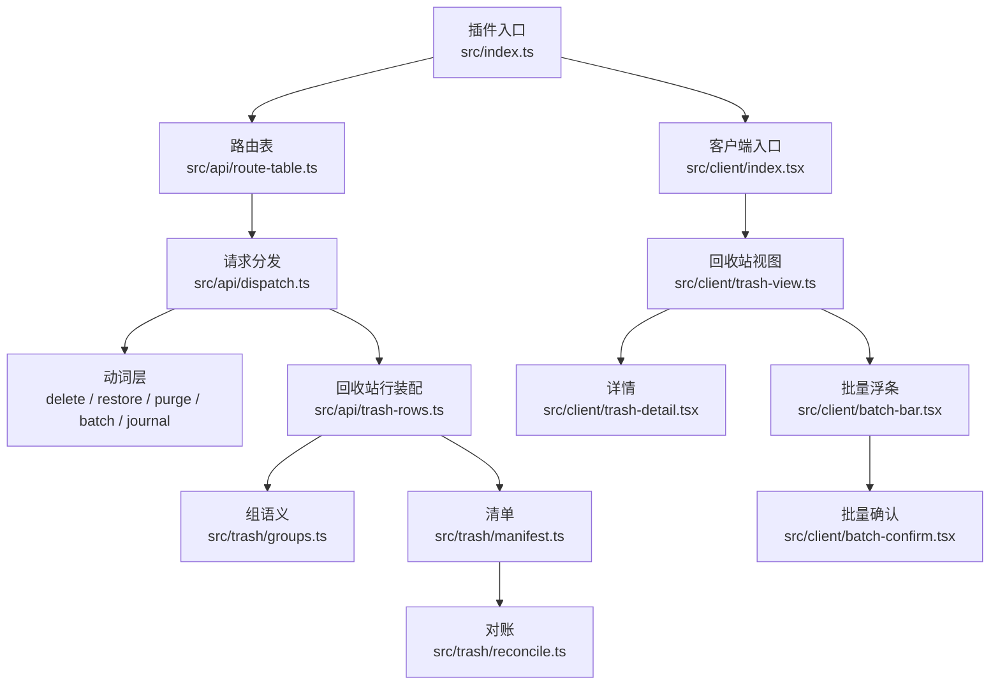
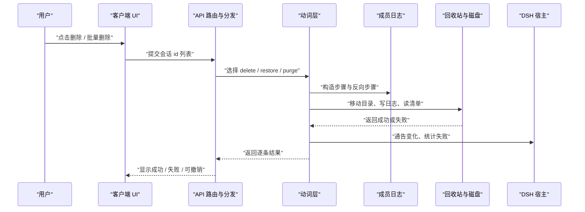
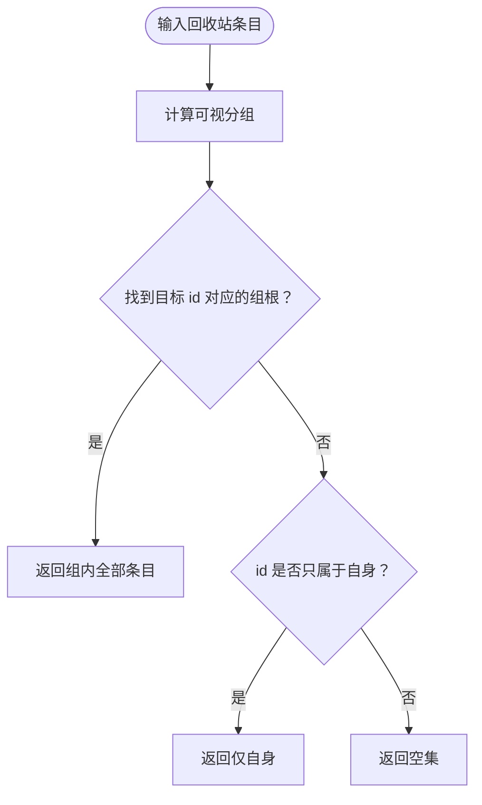
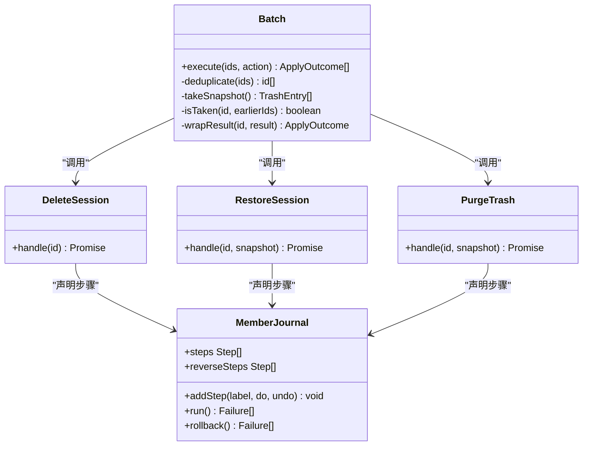
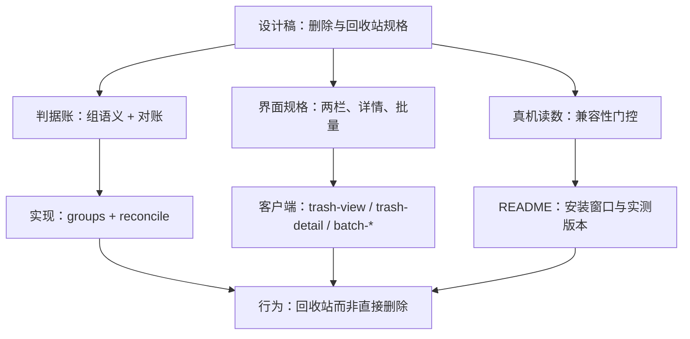
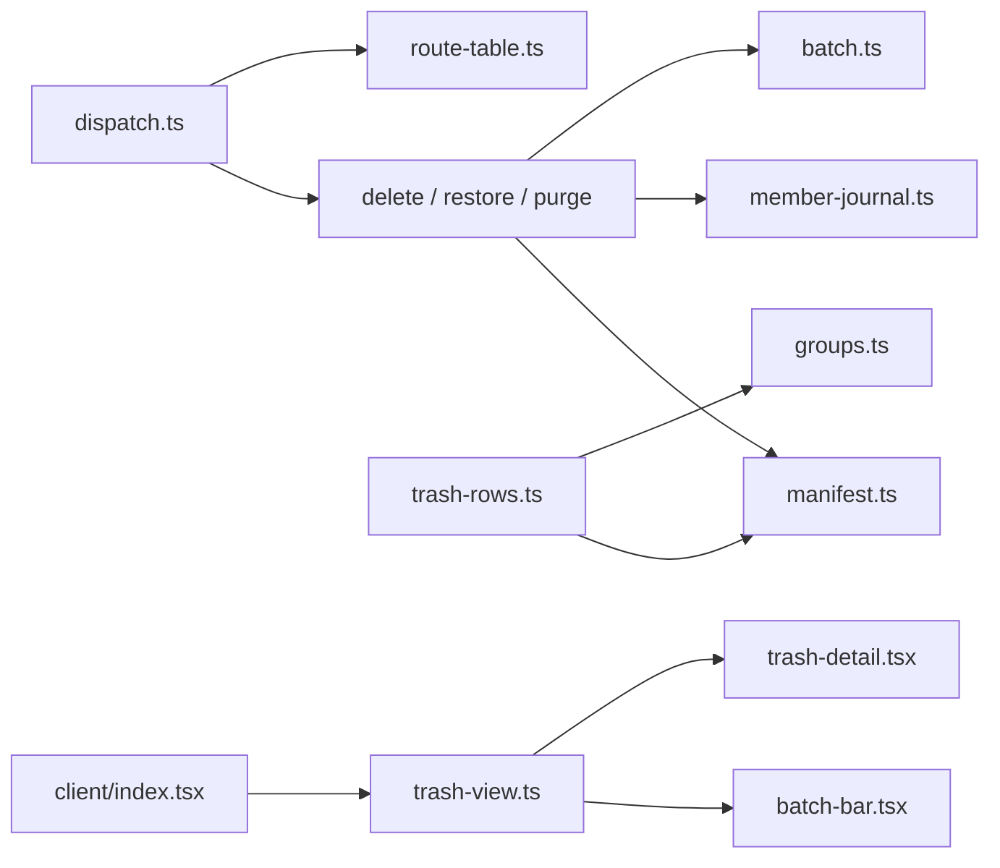

# 设计决策与日志

<cite>
**本文引用的文件**   
- [README.md](file://README.md)
- [docs/adr/README.md](file://docs/adr/README.md)
- [docs/adr/0001-group-membership-has-one-home.md](file://docs/adr/0001-group-membership-has-one-home.md)
- [docs/adr/0002-batch-and-journal-own-the-request.md](file://docs/adr/0002-batch-and-journal-own-the-request.md)
- [docs/adr/0003-wire-owns-the-online-shape.md](file://docs/adr/0003-wire-owns-the-online-shape.md)
- [docs/adr/0004-route-table-is-one-record.md](file://docs/adr/0004-route-table-is-one-record.md)
- [docs/design/2026-09-30-session-delete-design.md](file://docs/design/2026-09-30-session-delete-design.md)
- [docs/design/2026-10-15-trash-detail-design.md](file://docs/design/2026-10-15-trash-detail-design.md)
- [src/index.ts](file://src/index.ts)
- [src/api/dispatch.ts](file://src/api/dispatch.ts)
- [src/api/route-table.ts](file://src/api/route-table.ts)
- [src/api/trash-rows.ts](file://src/api/trash-rows.ts)
- [src/client/index.tsx](file://src/client/index.tsx)
- [src/client/trash-view.ts](file://src/client/trash-view.ts)
- [src/client/trash-detail.tsx](file://src/client/trash-detail.tsx)
- [src/client/trash-entry.tsx](file://src/client/trash-entry.tsx)
- [src/client/batch-bar.tsx](file://src/client/batch-bar.tsx)
- [src/client/batch-confirm.tsx](file://src/client/batch-confirm.tsx)
- [src/client/delete-confirm.tsx](file://src/client/delete-confirm.tsx)
- [src/client/trash-confirm.tsx](file://src/client/trash-confirm.tsx)
- [src/client/use-panel-width.ts](file://src/client/use-panel-width.ts)
- [src/verbs/batch.ts](file://src/verbs/batch.ts)
- [src/verbs/member-journal.ts](file://src/verbs/member-journal.ts)
- [src/verbs/delete-session.ts](file://src/verbs/delete-session.ts)
- [src/verbs/restore-session.ts](file://src/verbs/restore-session.ts)
- [src/verbs/purge-trash.ts](file://src/verbs/purge-trash.ts)
- [src/trash/groups.ts](file://src/trash/groups.ts)
- [src/trash/manifest.ts](file://src/trash/manifest.ts)
- [src/trash/reconcile.ts](file://src/trash/reconcile.ts)
- [tests/groups.test.ts](file://tests/groups.test.ts)
- [tests/reconcile.test.ts](file://tests/reconcile.test.ts)
</cite>

## 目录
1. [引言](#引言)
2. [项目结构](#项目结构)
3. [核心组件](#核心组件)
4. [架构总览](#架构总览)
5. [详细组件分析](#详细组件分析)
6. [依赖关系分析](#依赖关系分析)
7. [性能考量](#性能考量)
8. [故障排查指南](#故障排查指南)
9. [结论](#结论)
10. [附录：ADR 与设计日志对照](#附录adr-与设计日志对照)

## 引言
本项目是 DeepSeek Harness（DSH）的一个插件，目标是在宿主已有的“归档”能力之上补上“删除会话”的能力。其核心约束是：**删除不等于直接销毁，而是移入回收站；回收站可恢复，但需要显式操作才能彻底删除**。数据留在本机 `~/.dsh/session-trash/`，不联网、不上传；清单由插件自己的 storage domain 维护，并与回收站目录对账。

从仓库顶层 README 可见，本插件同时覆盖单条删除、整组删除、批量删除、恢复、清空回收站以及无主残留清理等场景；它还通过兼容性门控与语言本地化集成到 DSH 宿主生态中。

**章节来源**
- [README.md:1-147](file://README.md#L1-L147)

## 项目结构
仓库按“入口 → API → 动词层 → 回收站数据 → 客户端 UI → 测试”分层组织：

| 层级 | 主要职责 | 代表文件 |
|---|---|---|
| 插件入口 | 注册宿主路由、暴露面板与菜单项 | [src/index.ts](file://src/index.ts) |
| API 层 | 路由表、请求分发、回收站行装配 | [src/api/dispatch.ts](file://src/api/dispatch.ts)、[src/api/route-table.ts](file://src/api/route-table.ts)、[src/api/trash-rows.ts](file://src/api/trash-rows.ts) |
| 动词层 | 删除、恢复、清空、批量执行、成员日志 | [src/verbs/delete-session.ts](file://src/verbs/delete-session.ts)、[src/verbs/restore-session.ts](file://src/verbs/restore-session.ts)、[src/verbs/purge-trash.ts](file://src/verbs/purge-trash.ts)、[src/verbs/batch.ts](file://src/verbs/batch.ts)、[src/verbs/member-journal.ts](file://src/verbs/member-journal.ts) |
| 回收站数据 | 组语义、清单、对账 | [src/trash/groups.ts](file://src/trash/groups.ts)、[src/trash/manifest.ts](file://src/trash/manifest.ts)、[src/trash/reconcile.ts](file://src/trash/reconcile.ts) |
| 客户端 UI | 回收站面板、详情、批量确认、删除确认、撤销提示 | [src/client/trash-view.ts](file://src/client/trash-view.ts)、[src/client/trash-detail.tsx](file://src/client/trash-detail.tsx)、[src/client/batch-bar.tsx](file://src/client/batch-bar.tsx)、[src/client/batch-confirm.tsx](file://src/client/batch-confirm.tsx)、[src/client/delete-confirm.tsx](file://src/client/delete-confirm.tsx)、[src/client/trash-confirm.tsx](file://src/client/trash-confirm.tsx) |
| 测试 | 行为回归、UI 交互、错误路径 | [tests/groups.test.ts](file://tests/groups.test.ts)、[tests/reconcile.test.ts](file://tests/reconcile.test.ts) 等 |

**图示来源**
- [src/index.ts](file://src/index.ts)
- [src/api/route-table.ts](file://src/api/route-table.ts)
- [src/api/dispatch.ts](file://src/api/dispatch.ts)
- [src/api/trash-rows.ts](file://src/api/trash-rows.ts)
- [src/trash/groups.ts](file://src/trash/groups.ts)
- [src/trash/manifest.ts](file://src/trash/manifest.ts)
- [src/trash/reconcile.ts](file://src/trash/reconcile.ts)
- [src/client/index.tsx](file://src/client/index.tsx)
- [src/client/trash-view.ts](file://src/client/trash-view.ts)
- [src/client/trash-detail.tsx](file://src/client/trash-detail.tsx)
- [src/client/batch-bar.tsx](file://src/client/batch-bar.tsx)
- [src/client/batch-confirm.tsx](file://src/client/batch-confirm.tsx)

**章节来源**
- [README.md:1-147](file://README.md#L1-L147)

## 核心组件
### 回收站数据模型
- **回收站条目**：每个会话（包括父会话和跟随进入的子会话）对应一个目录；面板把一组条目折叠为一行。
- **清单**：独立于磁盘目录的索引，用于快速展示和批量操作。
- **对账**：每次读取清单时与回收站目录比对，处理手工搬动、丢失条目或外部目录等情况。
- **组语义**：以 `trash/groups.ts` 为唯一权威，提供可视分组、归属判断和批量幂等判据。

### 动词层
- **删除会话**：检查运行状态、收集整组成员、写入回收站、记录成员日志、通告宿主更新。
- **恢复会话**：把目录搬回原工作区，恢复归档可见性；若原工作区不存在则跳过账本挂接并归入“未分组”。
- **清空回收站**：先对账，再逐个彻底删除回收站条目；释放大小计算与界面合计保持一致。
- **批量执行**：去重保序、共享快照、收集逐条结果、支持部分失败后重试。
- **成员日志**：用步骤 + 反向步骤描述一次移动，保证回滚顺序与失败合并规则一致。

**章节来源**
- [src/trash/groups.ts](file://src/trash/groups.ts)
- [src/trash/manifest.ts](file://src/trash/manifest.ts)
- [src/trash/reconcile.ts](file://src/trash/reconcile.ts)
- [src/verbs/delete-session.ts](file://src/verbs/delete-session.ts)
- [src/verbs/restore-session.ts](file://src/verbs/restore-session.ts)
- [src/verbs/purge-trash.ts](file://src/verbs/purge-trash.ts)
- [src/verbs/batch.ts](file://src/verbs/batch.ts)
- [src/verbs/member-journal.ts](file://src/verbs/member-journal.ts)

## 架构总览
系统采用“同源栅栏 + 串行链”的方式控制风险：

1. **同源栅栏**：所有涉及会话状态的变更都经过同一套入口——API 路由与动词层。浏览器半只负责渲染、用户选择和调用服务端动作，不直接操作文件系统。
2. **串行链**：批量操作不是简单并行 N 次，而是按去重后的顺序逐条执行，失败不影响其他条目，并保留可重试的上下文。
3. **对账驱动清单**：清单不是磁盘的唯一真相；回收站目录与会话文件自描述共同构成最终事实，清单只是高效索引。
4. **回收站而非直接删除**：删除是可逆的第一阶段；只有显式“彻底删除”才会真正释放空间。

**图示来源**
- [src/api/dispatch.ts](file://src/api/dispatch.ts)
- [src/verbs/batch.ts](file://src/verbs/batch.ts)
- [src/verbs/member-journal.ts](file://src/verbs/member-journal.ts)
- [src/verbs/delete-session.ts](file://src/verbs/delete-session.ts)
- [src/verbs/restore-session.ts](file://src/verbs/restore-session.ts)
- [src/verbs/purge-trash.ts](file://src/verbs/purge-trash.ts)

## 详细组件分析

### ADR-0001：组成员归属只有一个家
#### 背景
早期“回收站里这一组有谁”被多处各自实现：
- 行装配只认根行；
- 某些动词只在非根时返回自身；
- 恢复逻辑复制了同样的分支；
- 清空逻辑使用简单的父子匹配，没有正确处理“父行自己也是孩子”的嵌套形状。

这种不一致在正常路径下不易触发，因为正常删除会把子条目指向刚生成的根行；但在嵌套组和彻底删除时，可能误删不属于该组的孙代目录，且后果不可恢复。

#### 权衡
- **集中 vs 分散**：集中到一个纯函数面会减少调用方理解成本，但也可能让模块承担更多概念。
- **接口宽度**：如果只提供“一行露面结果”，就会把“根”和“孩子”重新拆成两个函数，违背“一个概念一个家”的原则。
- **可变句柄 vs 参数传递**：可变快照会在同一批中被就地收缩，容易引发时序错误；改为传参让收缩时机回到调用方。

#### 结论
- 将组语义收进 `src/trash/groups.ts`，对外暴露三个纯函数：可视分组、归属判断、批量幂等判据。
- “能接住孩子的只有组根”成为可执行规则，不再靠注释维持。
- 清空逻辑改用统一判据，修复嵌套组行为；并通过回归测试锁定“父行自己也是孩子”的形状。

**图示来源**
- [docs/adr/0001-group-membership-has-one-home.md:1-50](file://docs/adr/0001-group-membership-has-one-home.md#L1-L50)
- [src/trash/groups.ts](file://src/trash/groups.ts)

**章节来源**
- [docs/adr/0001-group-membership-has-one-home.md:1-50](file://docs/adr/0001-group-membership-has-one-home.md#L1-L50)
- [tests/groups.test.ts](file://tests/groups.test.ts)

### ADR-0002：批量与日志拥有请求
#### 背景
批量语义原本散落在路由层和三个动词的接口中：
- 批量去重保序；
- 清册快照；
- “已被同批前一条带走”的判断；
- 三种不同的通知、回滚、失败收集机制；
- 正向与反向动作各手写一遍。

这导致调用方必须知道自己是第几个动作，且大量重复代码难以维护。

#### 权衡
- **抽出一个批量模块**：可以统一循环、快照、信封，但要把回滚语义一并考虑。
- **引入成员日志**：把“一次移动的步骤”从 try/catch 里抽出来，变成可观察的数据结构。
- **是否泛化撤销框架**：仓库明确拒绝通用撤销框架，因为当前边界只是“会话目录在 sessions 与 session-trash 之间搬动”。

#### 结论
- `src/verbs/batch.ts` 拥有“这一批”：去重、快照、幂等、逐条信封。
- `src/verbs/member-journal.ts` 拥有“一次移动”：步骤序列、相反顺序回滚、失败合并。
- 动词接口缩小为“一个 id 进、一条结果出”，批量副作用不再污染动词契约。
- 可观察语义保持不变：步骤顺序、回滚顺序、错误码和合并规则照旧。

**图示来源**
- [docs/adr/0002-batch-and-journal-own-the-request.md:1-77](file://docs/adr/0002-batch-and-journal-own-the-request.md#L1-L77)
- [src/verbs/batch.ts](file://src/verbs/batch.ts)
- [src/verbs/member-journal.ts](file://src/verbs/member-journal.ts)
- [src/verbs/delete-session.ts](file://src/verbs/delete-session.ts)
- [src/verbs/restore-session.ts](file://src/verbs/restore-session.ts)
- [src/verbs/purge-trash.ts](file://src/verbs/purge-trash.ts)

**章节来源**
- [docs/adr/0002-batch-and-journal-own-the-request.md:1-77](file://docs/adr/0002-batch-and-journal-own-the-request.md#L1-L77)

### ADR-0003：线上形状由 wire 拥有
#### 背景
线上数据形状和落地数据形状不能混用：
- 线上形状是浏览器与服务端之间的契约；
- 落地形状是磁盘、清单和动词层的内部表示；
- 投影转换必须显式写出，而不是隐式假设两者相同。

#### 权衡
- **分离好处**：避免线上字段漂移影响内部逻辑，也避免内部字段泄漏到浏览器契约。
- **代价**：每次新增字段都要同时维护映射，增加少量维护成本。

#### 结论
- 线上形状定义在 wire 相关文件中；
- 落地形状留在 entry 等内部模块；
- 投影逻辑显式编写，测试覆盖关键字段。

**章节来源**
- [docs/adr/0003-wire-owns-the-online-shape.md](file://docs/adr/0003-wire-owns-the-online-shape.md)

### ADR-0004：路由表是唯一记录
#### 背景
路由配置如果分散在多个地方，会出现方法名、纯度标记、body 解析不一致的风险。

#### 权衡
- **单一记录**：路由表集中管理，dispatch 只读它，降低漂移概率。
- **缺点**：新增路由时必须同步维护表，但这是可接受的维护点。

#### 结论
- 段名、方法、纯度、body 解析集中在 route-table；
- dispatch 只做查找和转发，不重新发明路由规则。

**章节来源**
- [docs/adr/0004-route-table-is-one-record.md](file://docs/adr/0004-route-table-is-one-record.md)

### 会话删除设计与回收站详情设计稿差异

#### 会话删除设计稿（2026-09-30）
该设计稿聚焦“删除会话”的整体流程，尤其是第十二批之后批量语义如何落到路由层，以及为什么需要把批量与日志分别拥有。它强调：
- 删除是“整组”行为；
- 任一成员运行即拒绝；
- 批量失败不连坐；
- 回滚与失败收集必须有稳定语义；
- 浏览器半不需要批量账本，只需要 N=1 的便捷路径。

#### 回收站详情设计稿（2026-10-15）
该设计稿更关注回收站面板的界面规格与判据账，特别是：
- 左清单右详情的布局；
- 按项目分组、可折叠、可拖分栏；
- 详情只显示真实提问与助手文字，不包含宿主注入的上下文或工具调用；
- 恢复时还原归档可见性；
- 页脚清空回收站前的对账与释放大小计算；
- 无主残留的条件提示与用户决定。

#### 判据账、真机读数、界面规格与最终实现的差异
| 维度 | 设计意图 | 最终实现要点 | 差异说明 |
|---|---|---|---|
| 判据账 | 通过统一组语义和对账消除多处规则不一致 | `trash/groups.ts` 提供可视分组、归属、幂等判据；`reconcile.ts` 在读取清单时与目录对账 | 设计稿提出方向，ADR-0001 与实现把它固化到纯函数与对账流程中 |
| 真机读数 | 兼容性与可用性要基于实际宿主版本验证 | README 明确安装窗口与已测桌面版本，运行时探测失败时不注册入口 | 设计稿侧重功能，README 补充兼容性门槛 |
| 界面规格 | 回收站两栏、详情正文、批量浮条、二次确认 | 视图、详情、批量确认、删除确认、清空确认分别实现，宽度不足时切换下钻 | 规格细化到组件级；宽窄布局由 `use-panel-width.ts` 等支撑 |
| 最终实现 | 删除可恢复、批量可重试、清空需对账 | 动词层走 batch + journal，API 层走 route-table + dispatch，客户端只消费结果 | 实现比设计稿更结构化，但行为保持“回收站优先” |

**图示来源**
- [docs/design/2026-09-30-session-delete-design.md](file://docs/design/2026-09-30-session-delete-design.md)
- [docs/design/2026-10-15-trash-detail-design.md](file://docs/design/2026-10-15-trash-detail-design.md)
- [docs/adr/0001-group-membership-has-one-home.md:1-50](file://docs/adr/0001-group-membership-has-one-home.md#L1-L50)
- [src/trash/reconcile.ts](file://src/trash/reconcile.ts)
- [src/client/trash-view.ts](file://src/client/trash-view.ts)
- [src/client/trash-detail.tsx](file://src/client/trash-detail.tsx)
- [src/client/batch-bar.tsx](file://src/client/batch-bar.tsx)
- [README.md:1-147](file://README.md#L1-L147)

**章节来源**
- [docs/design/2026-09-30-session-delete-design.md](file://docs/design/2026-09-30-session-delete-design.md)
- [docs/design/2026-10-15-trash-detail-design.md](file://docs/design/2026-10-15-trash-detail-design.md)
- [README.md:1-147](file://README.md#L1-L147)

## 依赖关系分析
### 模块耦合
- `dispatch` 依赖 `route-table` 获取路由元信息，再调用具体动词。
- `trash-rows` 依赖 `groups` 与 `manifest`，并对结果进行线上形状投影。
- 动词层依赖 `batch` 与 `member-journal`，并通过 `manifest` 读写清单。
- 客户端依赖视图、详情、批量确认、删除确认等组件，但不直接访问磁盘。

**图示来源**
- [src/api/dispatch.ts](file://src/api/dispatch.ts)
- [src/api/route-table.ts](file://src/api/route-table.ts)
- [src/api/trash-rows.ts](file://src/api/trash-rows.ts)
- [src/trash/groups.ts](file://src/trash/groups.ts)
- [src/trash/manifest.ts](file://src/trash/manifest.ts)
- [src/verbs/batch.ts](file://src/verbs/batch.ts)
- [src/verbs/member-journal.ts](file://src/verbs/member-journal.ts)
- [src/client/index.tsx](file://src/client/index.tsx)
- [src/client/trash-view.ts](file://src/client/trash-view.ts)
- [src/client/trash-detail.tsx](file://src/client/trash-detail.tsx)
- [src/client/batch-bar.tsx](file://src/client/batch-bar.tsx)

**章节来源**
- [src/api/dispatch.ts](file://src/api/dispatch.ts)
- [src/api/route-table.ts](file://src/api/route-table.ts)
- [src/api/trash-rows.ts](file://src/api/trash-rows.ts)
- [src/trash/groups.ts](file://src/trash/groups.ts)
- [src/trash/manifest.ts](file://src/trash/manifest.ts)
- [src/verbs/batch.ts](file://src/verbs/batch.ts)
- [src/verbs/member-journal.ts](file://src/verbs/member-journal.ts)
- [src/client/index.tsx](file://src/client/index.tsx)
- [src/client/trash-view.ts](file://src/client/trash-view.ts)
- [src/client/trash-detail.tsx](file://src/client/trash-detail.tsx)
- [src/client/batch-bar.tsx](file://src/client/batch-bar.tsx)

## 性能考量
- **批量快照**：批量操作共享一次清册快照，避免每条动词都重新读取清单，防止 N 条等于 N 次磁盘 IO。
- **纯函数组语义**：`groups.ts` 是无状态纯函数，便于复用和测试，也避免可变句柄带来的额外分配。
- **对账开销**：每次读取清单都会与回收站目录对账，这是以少量 IO 换取一致性的成本；对于大数量回收站，应关注扫描次数与缓存策略。
- **浏览器半轻量**：浏览器半不需要批量账本，只消费服务端结果，减少前端复杂度和内存占用。

[本节为通用性能讨论，不直接分析具体源码片段]

## 故障排查指南
### 常见问题与定位建议
| 现象 | 可能原因 | 排查路径 |
|---|---|---|
| 安装后侧栏没有“回收站” | 宿主兼容性不满足或通道探测失败 | 检查 README 中的引擎窗口与实测版本；确认宿主重启 |
| 删除后某行仍在列表中 | 宿主尚未不再列出该会话，或冷会话路径异常 | 刷新页面；检查宿主通告与客户端移除逻辑 |
| 正在运行的会话无法删除 | 活跃检查拒绝 | 查看运行会话 id；不要替用户终止任务 |
| 批量删除部分失败 | 逐条执行中存在不可恢复错误 | 查看失败行原文；使用“重试这 N 条” |
| 清空回收站释放大小与预期不符 | 释放计算未与组语义对齐 | 检查 `purge-trash` 与 `groups.ts` 的一致性 |
| 手工搬动回收站目录后行为异常 | 清单与目录不一致 | 等待下一次对账或使用面板恢复 |

**章节来源**
- [README.md:1-147](file://README.md#L1-L147)
- [tests/reconcile.test.ts](file://tests/reconcile.test.ts)

## 结论
本项目的架构决策围绕三条主线展开：
1. **回收站优先**：删除是可恢复的第一步，彻底删除必须显式执行，避免误删不可恢复。
2. **对账驱动清单**：清单不是磁盘真相，而是高效索引；一致性由对账保障。
3. **同源栅栏加串行链**：变更统一走 API 与动词层，批量逐条执行、失败隔离、回滚有序。

ADR-0001 到 ADR-0004 分别收敛了组语义、批量与日志、线上形状、路由表四个高风险领域；两份设计稿则记录了从功能意图到界面规格再到实现落地的演进。后续变更应遵循：
- 修改“谁拥有什么”前先查 ADR 索引；
- 任何行为变化都要有回归测试；
- 界面文案与释放大小必须与后端判据一致；
- 浏览器半与 Node 半的职责边界不能模糊。

## 附录：ADR 与设计日志对照
- ADR 索引说明每篇只记录难逆转、无上下文会让人惊讶、曾经存在替代方案的决定。
- 编号只追加不重排，翻案方式按 AGENTS 规范处理。
- 本仓库把“批次账与真机读数”放在两份设计日志中，当前现状以代码与本索引为准。

**章节来源**
- [docs/adr/README.md:1-14](file://docs/adr/README.md#L1-L14)
- [docs/adr/0001-group-membership-has-one-home.md:1-50](file://docs/adr/0001-group-membership-has-one-home.md#L1-L50)
- [docs/adr/0002-batch-and-journal-own-the-request.md:1-77](file://docs/adr/0002-batch-and-journal-own-the-request.md#L1-L77)
- [docs/adr/0003-wire-owns-the-online-shape.md](file://docs/adr/0003-wire-owns-the-online-shape.md)
- [docs/adr/0004-route-table-is-one-record.md](file://docs/adr/0004-route-table-is-one-record.md)