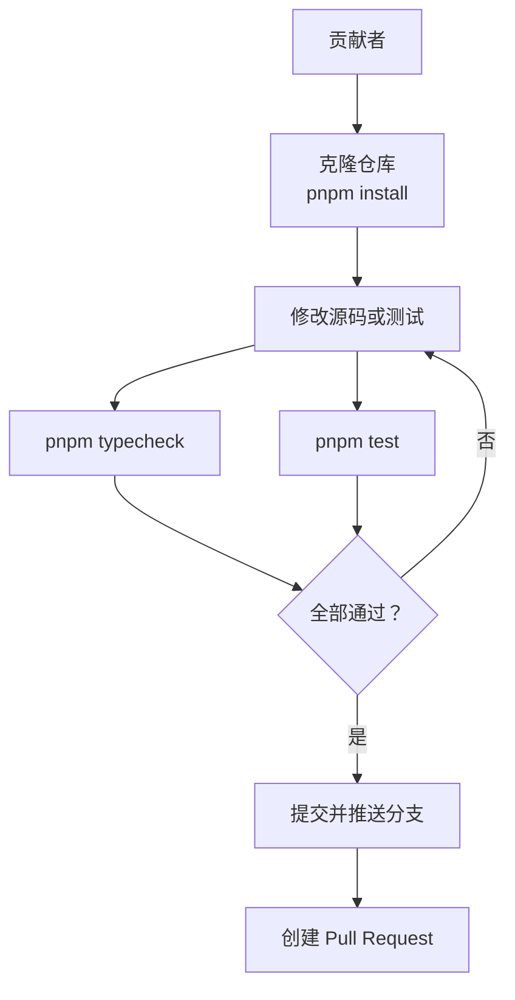
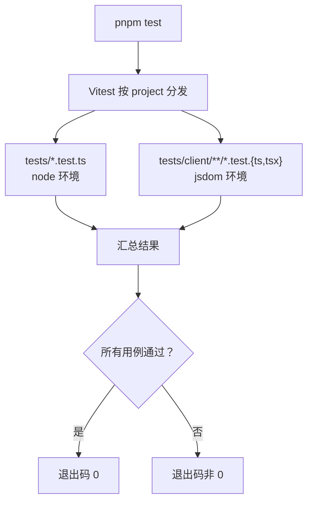
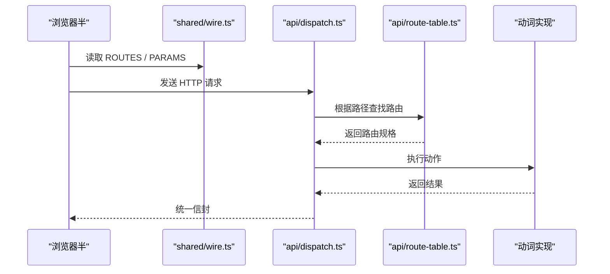

# 贡献指南

<cite>
**本文引用的文件**   
- [README.md](file://README.md)
- [package.json](file://package.json)
- [vitest.config.ts](file://vitest.config.ts)
- [tsconfig.json](file://tsconfig.json)
- [AGENTS.md](file://AGENTS.md)
- [src/shared/wire.ts](file://src/shared/wire.ts)
- [src/api/route-table.ts](file://src/api/route-table.ts)
- [src/api/dispatch.ts](file://src/api/dispatch.ts)
</cite>

## 目录
1. [简介](#简介)
2. [仓库概览与术语](#仓库概览与术语)
3. [环境准备与最小流程](#环境准备与最小流程)
4. [分支与提交约定](#分支与提交约定)
5. [测试规则](#测试规则)
6. [类型检查规则](#类型检查规则)
7. [新增 API 的规则](#新增-api-的规则)
8. [新增文案的规则](#新增文案的规则)
9. [代码风格与命名约定](#代码风格与命名约定)
10. [Issue、PR 模板与审查期望](#issuepr-模板与审查期望)
11. [许可与社区沟通](#许可与社区沟通)
12. [第一个贡献者：从 clone 到 PR 的最小示例](#第一个贡献者从-clone-到-pr-的最小示例)
13. [常见问题排查](#常见问题排查)
14. [结语](#结语)

## 简介
本插件为 DeepSeek Harness（DSH）补充“删除会话”能力：删除等于移入回收站并可恢复，同时提供显式彻底删除。仓库采用 TypeScript + Vitest 双项目测试配置，Node 半与浏览器半由同一份 wire 契约连接；API 段名、动作、请求字段集中定义在共享 wire 文件中，路由处理集中在路由表。

贡献前请先阅读根 `README.md` 中的功能说明、安装方式与开发命令；本文聚焦如何 fork、创建分支、写测试、跑通类型检查与 Vitest，再提交 PR。

**章节来源**
- [README.md:1-147](file://README.md#L1-L147)

## 仓库概览与术语
- Node 半：宿主侧入口、HTTP API、存储域、动词实现等，位于 `src/` 下多个子目录。
- 浏览器半：UI 与客户端逻辑，位于 `src/client/`。
- 共享契约：跨两端的 API 形状、段名、参数键集中在 `src/shared/wire.ts`。
- 路由表：Node 半的 HTTP 路由与执行语义集中在 `src/api/route-table.ts`。
- 测试：Vitest 把 Node 用例放在 `tests/*.test.ts`，浏览器用例放在 `tests/client/**/*.test.{ts,tsx}`。



[此图为概念流程图，不直接映射具体源码，因此不提供图示来源]

**章节来源**
- [vitest.config.ts:1-31](file://vitest.config.ts#L1-L31)
- [package.json:1-105](file://package.json#L1-L105)

## 环境准备与最小流程
### 前置条件
- Node.js 版本需满足包声明要求。
- 使用 pnpm 管理依赖。

### 安装与构建
1. 克隆你 fork 后的仓库。
2. 安装依赖：`pnpm install`。
3. 构建产物：`pnpm build`。
4. 运行类型检查：`pnpm typecheck`。
5. 运行测试：`pnpm test`。

### 本地调试
- 浏览器半（`src/client/`）由宿主 HMR 更新，无需重启宿主。
- Node 半不在热重载链路内，需要重启宿主才能生效。
- 若以源码链接方式调试，需要先手动 `pnpm build`，再通过 dsh 插件链接机制加载。

**章节来源**
- [package.json:1-105](file://package.json#L1-L105)
- [README.md:100-147](file://README.md#L100-L147)

## 分支与提交约定
- Fork 仓库到你的 GitHub 账号。
- 基于 `main` 创建功能分支，分支名应表达改动范围，例如 `feat/delete-batch-test`、`fix/orphan-clean-error`、`docs/contributing`。
- 每次提交尽量保持单一职责：一个 bug 修复、一项功能、一组相关测试。
- 提交信息建议使用中文，简要说明“做了什么”，必要时补充“为什么这样做”。
- 不要在提交里混入无关格式化改动；如果确实要格式化，请单独提交。

[本节为通用贡献规范，未直接分析具体源码文件，因此不提供章节来源]

## 测试规则
### 测试框架与项目划分
仓库使用 Vitest，并明确划分为两个 project：
- `node`：匹配 `tests/*.test.ts`，运行环境为 `node`。
- `client`：匹配 `tests/client/**/*.test.{ts,tsx}`，运行环境为 `jsdom`，并带有专用 setup 文件。



**图示来源**
- [vitest.config.ts:1-31](file://vitest.config.ts#L1-L31)

### 编写新测试的原则
- 新增功能必须配套测试：Node 半逻辑放在 `tests/` 下的 `.test.ts`，浏览器 UI 行为放在 `tests/client/` 下的 `.test.tsx`。
- 不要只改业务代码而不改测试；也不要只加空测试。
- 如果现有测试覆盖的是线上形状或路由契约，新增 API 时优先同步这些契约测试。
- 测试失败时先理解断言失败原因，而不是盲目扩大 mock。

### 确保 Vitest 全部通过
- 新增或修改测试后，必须执行 `pnpm test`。
- 必须确认命令返回成功退出码，不能只看控制台输出——管道会吞掉退出码，这是 README 中明确提醒的门控注意事项。
- 浏览器半改动要在有可见浏览器的隔离 profile 上验证，因为客户端激活失败会被宿主视为致命错误。

**章节来源**
- [vitest.config.ts:1-31](file://vitest.config.ts#L1-L31)
- [README.md:120-147](file://README.md#L120-L147)
- [AGENTS.md:1-62](file://AGENTS.md#L1-L62)

## 类型检查规则
### 类型检查命令
```bash
pnpm typecheck
```
该命令等价于 TypeScript 编译器以 `--noEmit` 模式检查当前仓库包含的源码与测试。

### 严格模式含义
- 开启严格类型检查。
- 禁止未使用的局部变量和参数。
- JSX 使用 React JSX transform。
- 目标语言特性为 ES2022，模块解析为 Bundler 模式。

### 类型检查失败时的常见原因
- 新增 API 后忘记更新共享 wire 或路由表类型。
- 浏览器半导入了不允许的平台模块。
- 测试里 mock 的形状与实际类型不一致。
- 新增变量或参数但未在调用处使用。

**章节来源**
- [package.json:1-105](file://package.json#L1-L105)
- [tsconfig.json:1-10](file://tsconfig.json#L1-L10)

## 新增 API 的规则
### 核心原则：一份真相，两处消费
新增 API 时必须同时维护三个位置：
1. 共享 wire：`src/shared/wire.ts`。
2. 路由表：`src/api/route-table.ts`。
3. 对应测试：Node 半或浏览器半的 Vitest 用例。

### 共享 wire：`src/shared/wire.ts`
这是 Node 半与浏览器半之间唯一的数据契约，负责：
- API 前缀。
- 六个端点段名。
- `/apply` 的动作类型。
- 线上数据结构。
- 请求参数键。
- 失败信封形状。

新增 API 时，至少检查：
- 是否需要新的段名。
- 是否需要新的动作。
- 是否需要新的请求参数键。
- 是否需要新的响应形状。
- 两端是否都需要同步消费。



**图示来源**
- [src/shared/wire.ts:1-261](file://src/shared/wire.ts#L1-L261)
- [src/api/dispatch.ts:1-200](file://src/api/dispatch.ts#L1-L200)
- [src/api/route-table.ts:1-143](file://src/api/route-table.ts#L1-L143)

### 路由表：`src/api/route-table.ts`
路由表决定：
- 每个段名允许的方法。
- 是否需要读请求体。
- 是否进入串行链。
- 实际处理函数。

新增段名时，必须在 `ROUTE_TABLE` 中添加一条记录；新增 `/apply` 动作时，类型系统会通过派生类型强制你补齐处理逻辑。

**章节来源**
- [src/shared/wire.ts:1-261](file://src/shared/wire.ts#L1-L261)
- [src/api/route-table.ts:1-143](file://src/api/route-table.ts#L1-L143)
- [src/api/dispatch.ts:1-200](file://src/api/dispatch.ts#L1-L200)

### 测试同步
- 如果新增的是 HTTP 段名，优先检查 `tests/api.test.ts`、`tests/route-table.test.ts`、`tests/wire-shape.test.ts` 等契约类测试。
- 如果新增的是浏览器端查询或 UI 交互，优先检查 `tests/client/` 下对应的测试。
- 不要绕过类型检查来“让测试看起来通过”。

**章节来源**
- [vitest.config.ts:1-31](file://vitest.config.ts#L1-L31)

## 新增文案的规则
### 文案来源
界面文案挂在宿主 locale 服务上，默认支持中文与英文；当宿主 locale 服务不可用时回退到内置中文。

### 新增或更新文案的步骤
1. 找到当前使用的文案键。
2. 在对应 locale 文件中新增或更新文案：
   - `locale/zh.json`：中文。
   - `locale/en.json`：英文。
3. 如果文案用于浏览器 UI，还要在浏览器端组件中确认文案键一致。
4. 补充或更新相关测试，尤其是涉及用户可见消息的测试。
5. 确保 `pnpm test` 与 `pnpm typecheck` 都通过。

### 注意事项
- 文案变更不是纯内部改动，可能影响已有测试断言。
- 如果宿主 locale 服务不可用，代码会走内置中文降级路径；新增文案时要考虑这条降级路径是否也需要覆盖。
- 文案应与宿主界面语言保持一致，不要硬编码另一套语言选择。

**章节来源**
- [README.md:85-100](file://README.md#L85-L100)
- [package.json:1-105](file://package.json#L1-L105)

## 代码风格与命名约定
### TypeScript 与项目配置
- 使用严格模式。
- 禁用未使用变量与参数。
- JSX 使用 React JSX transform。
- 模块解析遵循 bundler 模式。

### 浏览器半约束
- 浏览器半不得 import 宿主客户端 UI 包。
- 需要的控件已按官方处方复制到 `src/client/ui/*`。
- 浏览器半构建产物受 tsdown 纯度门限制，新增第三方依赖要谨慎评估打包体积与平台兼容性。

### 命名建议
- 文件名使用小写、短横线分隔或符合现有目录结构。
- 常量使用大写加下划线，如已有 `SESSION_DELETE_API_PREFIX`。
- 函数与变量使用具象语义化名称，避免无意义缩写。
- 新增的类型、接口与枚举应尽量靠近其语义所在层，不要散落多处。

### 架构一致性
- 新增判据前先查架构文档与 ADR，确认“唯一主人”是谁。
- 不要把同一事实写在四处以上；仓库明确要求“一条事实只住一个家”。
- 改动浏览器半后，应在真实桌面环境中冒烟验证，避免前端自检致命失败被 headless 测试漏掉。

**章节来源**
- [tsconfig.json:1-10](file://tsconfig.json#L1-L10)
- [AGENTS.md:1-62](file://AGENTS.md#L1-L62)

## Issue、PR 模板与审查期望
### Issue
- 报告 bug 时说明复现步骤、预期行为与实际行为。
- 报告功能需求时说明使用场景、替代方案与代价。
- 如涉及宿主兼容性问题，说明 DSH 版本与实测情况。

### Pull Request
- PR 应聚焦单一改动范围。
- 描述中说明改动目的、影响范围与测试策略。
- 自测清单至少包括：
  - `pnpm typecheck` 通过。
  - `pnpm test` 通过。
  - 浏览器半改动已在真实桌面环境冒烟。
  - 新增 API 已同步 wire 与 route-table。
  - 新增文案已更新 locale 文件。

### 审查关注点
- 是否符合“唯一主人清单”与 ADR。
- 是否破坏 wire 契约。
- 是否引入浏览器半非法导入。
- 是否遗漏测试。
- 是否改变公开行为但没有说明。

**章节来源**
- [README.md:120-147](file://README.md#L120-L147)
- [AGENTS.md:1-62](file://AGENTS.md#L1-L62)

## 许可与社区沟通
### 许可证
- 本项目采用 Apache-2.0 许可。
- 提交即表示你同意以 Apache-2.0 授权你的贡献。
- 请在提交前确认你有权限贡献所用代码。

### 社区沟通渠道
- 问题反馈：GitHub Issues。
- 仓库主页与使用说明：GitHub README。
- 包发布与版本信息：npm 页面。

**章节来源**
- [README.md:1-20](file://README.md#L1-L20)
- [README.md:120-147](file://README.md#L120-L147)
- [package.json:1-105](file://package.json#L1-L105)

## 第一个贡献者：从 clone 到 PR 的最小示例
以下是一个从零开始的完整示例，适合第一次贡献者：

1. 在 GitHub 上 fork 仓库。
2. 克隆你自己的 fork：
   ```bash
   git clone https://github.com/<你的用户名>/dsh-session-delete.git
   cd dsh-session-delete
   ```
3. 安装依赖：
   ```bash
   pnpm install
   ```
4. 确认基础状态：
   ```bash
   pnpm typecheck
   pnpm test
   ```
5. 创建功能分支：
   ```bash
   git checkout -b feat/add-your-feature
   ```
6. 修改源码或新增测试。
7. 再次运行：
   ```bash
   pnpm typecheck
   pnpm test
   ```
8. 确认两条命令都成功返回：
   ```bash
   pnpm typecheck && echo "typecheck ok"
   pnpm test && echo "tests ok"
   ```
9. 提交更改：
   ```bash
   git add .
   git commit -m "feat: 添加某功能的说明"
   git push origin feat/add-your-feature
   ```
10. 在 GitHub 上创建 Pull Request，目标分支为 `main`。
11. 在 PR 描述中写明改动目的、测试情况和任何已知限制。

[本节为通用操作示例，不直接分析具体源码文件，因此不提供章节来源]

## 常见问题排查
### `pnpm test` 部分通过
- 确认是否只跑了某个 subset，而非 `pnpm test`。
- 检查 vitest 配置中的 include 模式是否匹配到你新增的测试文件。
- 浏览器半测试失败时，优先检查 jsdom 环境下的 DOM、React 渲染与事件模拟。

### `pnpm typecheck` 报错但能运行
- TypeScript 类型检查比运行期更严格，必须先修类型错误。
- 如果是新增 API 导致的类型错误，检查 `wire.ts` 与 `route-table.ts` 是否同步。

### 浏览器半在宿主中崩溃
- 客户端条目激活失败会被宿主视为致命错误。
- 浏览器半改动后，先在隔离 profile 中验证，再推向 live profile。
- 不要导入宿主客户端 UI 包；应使用 `src/client/ui/*` 中的本地控件。

### 新增 API 后客户端探测失败
- 检查 API 前缀、段名、方法与路由表是否一致。
- 检查同源栅栏是否放行桌面壳请求。
- 检查 wire 中是否暴露了新的参数键或响应形状。

**章节来源**
- [vitest.config.ts:1-31](file://vitest.config.ts#L1-L31)
- [AGENTS.md:1-62](file://AGENTS.md#L1-L62)
- [src/api/dispatch.ts:1-200](file://src/api/dispatch.ts#L1-L200)
- [src/shared/wire.ts:1-261](file://src/shared/wire.ts#L1-L261)

## 结语
贡献的核心不是“写完代码”，而是“让类型检查通过、让所有测试通过、让契约保持一致、让浏览器半不会在真实宿主中崩溃”。新增 API 时记住三条红线：同步 `src/shared/wire.ts`、同步 `src/api/route-table.ts`、同步测试；新增文案时记得更新 locale 文件；提交前务必亲眼确认 `pnpm typecheck` 与 `pnpm test` 的退出码都为成功。

[本节为总结性内容，未直接分析具体源码文件，因此不提供章节来源]