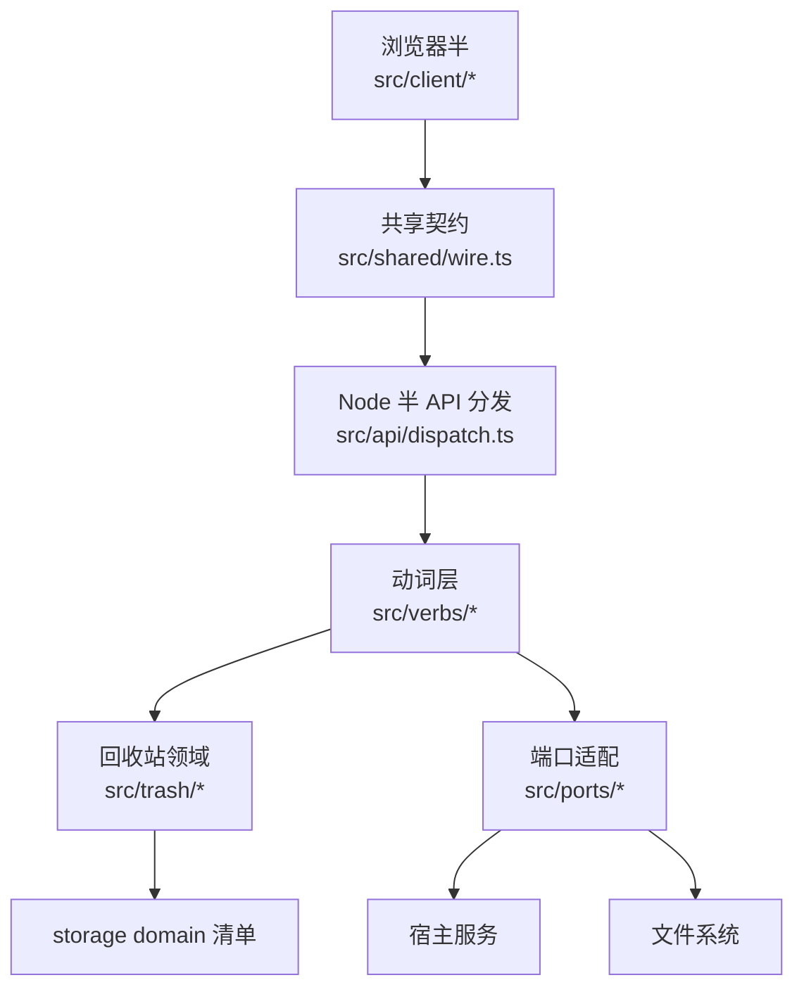
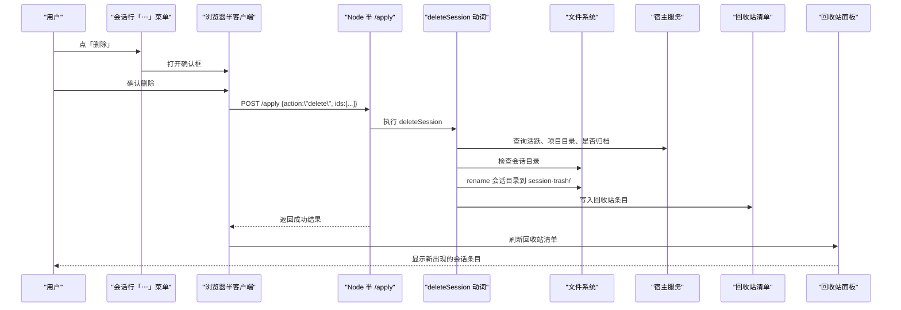
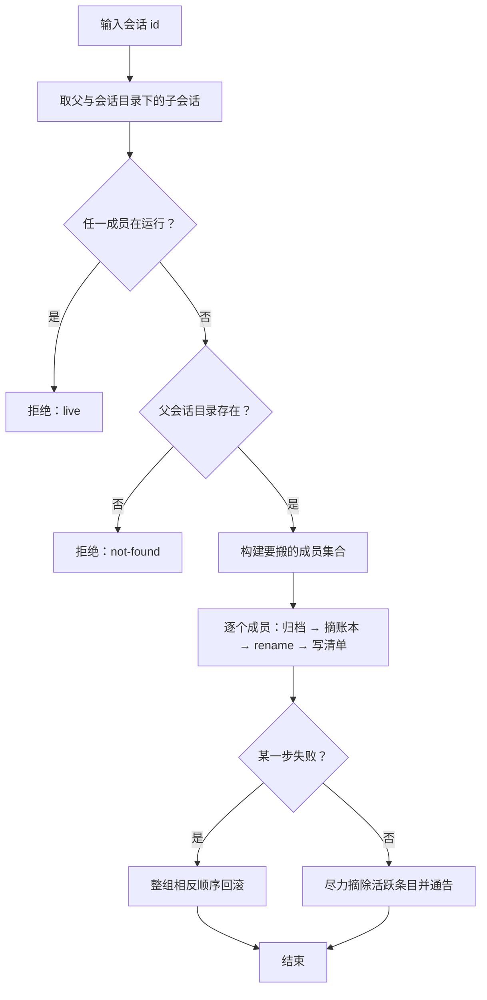
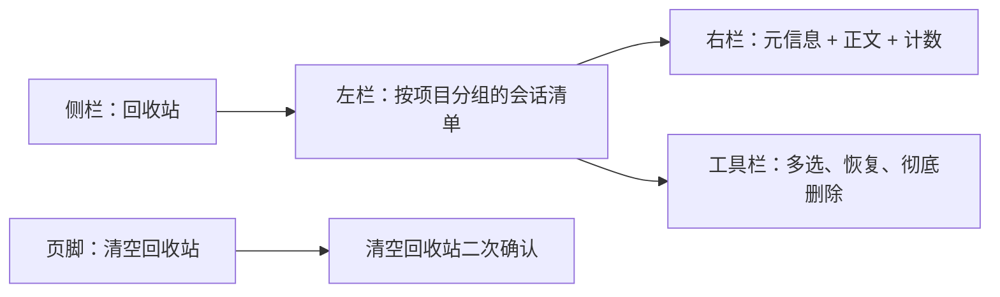
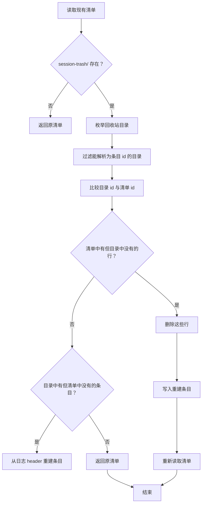
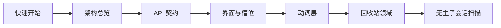

# 项目总览

<cite>
**本文引用的文件**   
- [README.md](file://README.md)
- [package.json](file://package.json)
- [docs/architecture.md](file://docs/architecture.md)
- [docs/design/2026-09-30-session-delete-design.md](file://docs/design/2026-09-30-session-delete-design.md)
- [docs/design/2026-10-15-trash-detail-design.md](file://docs/design/2026-10-15-trash-detail-design.md)
- [src/index.ts](file://src/index.ts)
- [src/api/dispatch.ts](file://src/api/dispatch.ts)
- [src/shared/wire.ts](file://src/shared/wire.ts)
- [src/client/index.tsx](file://src/client/index.tsx)
- [src/verbs/delete-session.ts](file://src/verbs/delete-session.ts)
- [src/trash/reconcile.ts](file://src/trash/reconcile.ts)
- [src/client/trash-view.ts](file://src/client/trash-view.ts)
</cite>

## 目录

1. [快速开始](#快速开始)
2. [插件定位与数据范围](#插件定位与数据范围)
3. [双半架构总览](#双半架构总览)
4. [端到端示例：从菜单到回收站面板](#端到端示例从菜单到回收站面板)
5. [核心组件与职责](#核心组件与职责)
6. [API 契约与动词层](#api-契约与动词层)
7. [界面与槽位](#界面与槽位)
8. [回收站领域](#回收站领域)
9. [无主子会话扫描](#无主子会话扫描)
10. [宿主版本、安装与隐私承诺](#宿主版本安装与隐私承诺)
11. [面向初学者的阅读路径](#面向初学者的阅读路径)
12. [故障排查要点](#故障排查要点)
13. [结论](#结论)

## 快速开始

| 事项 | 内容 |
|---|---|
| 插件名 | `@xrn1997/dsh-session-delete` |
| 一句话定位 | DSH 官方提供「归档」但不提供「删除」；本插件补上真正的删除，并把它做成可恢复的回收站操作。 |
| 安装命令 | `dsh plugin --profile <profile> add @xrn1997/dsh-session-delete` |
| 卸载命令 | `dsh plugin --profile <profile> remove @xrn1997/dsh-session-delete` |
| 安装后要求 | **重启宿主**。Node 半不走热重载；浏览器半由宿主 HMR 推送。 |
| 离线分发 | `pnpm pack` 出 tarball 后，用 `dsh plugin add ./dsh-session-delete-<版本>.tgz` 安装。 |
| 本地调试 | 源码目录先跑 `pnpm build`，再用 `dsh plugin --profile <profile> add "link:<绝对路径>"` 链进 profile。 |

安装完成后，DSH 桌面端的会话行「⋯」菜单会多出「多选」和「删除」；侧栏多出一行「回收站」，用于查看、恢复、彻底删除或清空已移入回收站的会话。

**章节来源**
- [README.md:1-147](file://README.md#L1-L147)
- [package.json:1-105](file://package.json#L1-L105)

## 插件定位与数据范围

### 它解决什么问题

DSH 官方把「归档」做成一等能力，但没有真正删除会话的入口。归档只是把会话从列表里挪走，磁盘上的会话本体、日志、附件都还在。本插件的目标不是替代归档，而是在归档之外补上**可恢复的删除**：

- 普通删除 = 把会话移入回收站。
- 恢复 = 从回收站搬回原项目目录，并按删除前的归档可见性还原。
- 彻底删除 = 永久释放目录和清册行。
- 清空回收站 = 一次性处理全部可识别条目。
- 无主子会话扫描 = 发现父会话已经不在语料或清册中的子会话残留，由用户决定是否清理。

### 本地数据范围

| 对象 | 位置 | 归属 |
|---|---|---|
| 会话本体 | `~/.dsh/sessions/<项目目录>/<会话目录>/` | 宿主 |
| 回收站本体 | `~/.dsh/session-trash/<时间戳>-<原目录名>/` | 本插件 |
| 回收站清单 | 宿主 storage domain，介质在 `~/.dsh/storages/` | 本插件 |
| 附件 | 全局内容寻址目录 | 不随会话删除连带回收 |

关键约束是：**回收站必须与 `sessions/` 同卷**，因为删除和恢复依赖整目录 `rename`，跨卷会失败。回收站不会联网、不会上传；清单丢失也不致命，因为会话日志头包含 `id` 与 `cwd`，每次读清单都会与 `session-trash/` 目录对账。

**章节来源**
- [docs/design/2026-09-30-session-delete-design.md:3-5](file://docs/design/2026-09-30-session-delete-design.md#L3-L5)
- [docs/architecture.md:55-70](file://docs/architecture.md#L55-L70)
- [README.md:60-90](file://README.md#L60-L90)

## 双半架构总览

这个仓库产两个运行半：

**图示来源**
- [docs/architecture.md:1-30](file://docs/architecture.md#L1-L30)
- [src/api/dispatch.ts:1-40](file://src/api/dispatch.ts#L1-L40)
- [src/shared/wire.ts:1-40](file://src/shared/wire.ts#L1-L40)

### 设计原则

- **通道是自建薄线**：不是官方 `remote.<namespace>`，而是宿主 web server 上的插件专属前缀路由 `/dsh-session-delete-api`。
- **浏览器半不持真相**：视图、选择态、确认框、面板只消费投影；真实状态在 Node 半的会话目录、宿主注册表和 storage domain 清单中。
- **Node 半分层清晰**：ports → trash → verbs → api → index.ts。动词层不 import api，路由层只做传输、查表与信封包装。
- **两半通过 wire.ts 对齐**：段名、请求字段、失败码、线上形状都在同一份文件中声明。
- **槽位贡献受宿主门控**：浏览器半只在通道探测通过后注册入口；探测不过时，一个入口都不出现，而不是展示禁用态 UI。

**章节来源**
- [docs/architecture.md:1-54](file://docs/architecture.md#L1-L54)
- [src/index.ts:1-40](file://src/index.ts#L1-L40)

## 端到端示例：从菜单到回收站面板

下面是一个初学者也能跟随的完整流程，覆盖从用户点击到回收站面板显示的每一步。

**图示来源**
- [src/client/index.tsx:1-80](file://src/client/index.tsx#L1-L80)
- [src/api/dispatch.ts:140-200](file://src/api/dispatch.ts#L140-L200)
- [src/verbs/delete-session.ts:1-120](file://src/verbs/delete-session.ts#L1-L120)
- [src/shared/wire.ts:40-90](file://src/shared/wire.ts#L40-L90)

### 关键行为说明

1. 用户点会话行「⋯」→「删除」。
2. 浏览器半弹出确认框，并提示这一组有多少子会话。
3. 浏览器半调用 `POST /apply`，动作是 `delete`。
4. Node 半校验：
   - 该会话（含盘上子会话）是否在运行；
   - 父会话目录是否存在；
   - 能否 `rename` 到回收站；
   - 能否写入回收站清单。
5. 任一成员在运行则拒绝，零副作用。
6. 成功后，回收站面板刷新，该会话出现在对应项目分组下。
7. 如果宿主的活跃会话列表仍保留该会话，插件还会尝试摘除内存条目并通告客户端移除该行。

**章节来源**
- [src/client/index.tsx:80-160](file://src/client/index.tsx#L80-L160)
- [src/verbs/delete-session.ts:1-120](file://src/verbs/delete-session.ts#L1-L120)
- [docs/design/2026-09-30-session-delete-design.md:40-120](file://docs/design/2026-09-30-session-delete-design.md#L40-L120)

## 核心组件与职责

### Node 半组合根：`src/index.ts`

它是插件激活入口，负责：

- 声明插件名与注入项：`workspaceRegistry`、`storageDomain`、`webServer`。
- 定义回收站 storage domain 的名称、布局与记录 schema。
- 懒开 storage domain 句柄，并在插件卸载时关闭。
- 组装 Node 半 HTTP API 处理器。
- 解析宿主数据根 `~/.dsh/`。

重要命名约定：

- storage domain 名为 `xrn1997_session_delete_trash`，带插件 scope 前缀，避免与其他插件冲突。
- domain 名必须过宿主 `UNIT_NAME_RE`，只能小写字母、数字和下划线。
- 清单使用 `per-record` 布局 + `backup-and-skip`：一条坏记录被备份并跳过，不会让域整体打不开。

**章节来源**
- [src/index.ts:1-120](file://src/index.ts#L1-L120)

### API 分发：`src/api/dispatch.ts`

它只做三件事：同源栅栏、查路由表、写信封。

- 只接受本机回环地址。
- 允许浏览器直接访问、桌面壳转发、以及 Referer 为桌面壳的请求。
- 所有操作失败统一返回 `{ ok: false, error }`，HTTP 状态 200。
- 请求本身不对才返回 4xx。
- 非纯读请求进入到达序串行链，防止「对账 + 写清单」与「删除/恢复/彻底删除」交错造成半一致。

**章节来源**
- [src/api/dispatch.ts:1-120](file://src/api/dispatch.ts#L1-L120)

### 共享契约：`src/shared/wire.ts`

这是两半之间唯一共享的运行时契约，包括：

- API 前缀：`/dsh-session-delete-api`
- 六个段名：`list`、`ping`、`detail`、`apply`、`empty`、`orphans`
- `ApplyAction`：`delete`、`restore`、`purge`、`count`、`orphan-clean`
- 线上消息形状：`TrashEntryWire`、`TrashRowWire`、`TrashDetailWire`、`PurgeStatsWire`、`OrphanReportWire`
- 失败信封：`RemoteFailure`
- 远程结果：`RemoteResult<T>`

**章节来源**
- [src/shared/wire.ts:1-120](file://src/shared/wire.ts#L1-L120)

## API 契约与动词层

### 六个段名

| 段名 | 方法 | 作用 | 是否写清单 |
|---|---|---|---|
| `/list` | GET | 对账并读取回收站清单 | 是 |
| `/ping` | GET | 通道探测，不碰盘 | 否 |
| `/detail` | POST | 读取单条回收站会话的日志正文 | 否 |
| `/apply` | POST | 批量执行一个动作 | 视动作而定 |
| `/empty` | POST | 清空回收站 | 是 |
| `/orphans` | GET | 扫描无主子会话报告 | 否 |

`/apply` 是写动作的统一入口。单条操作就是长度为 1 的批量，仓内不再维护第二条执行路径。

**章节来源**
- [src/shared/wire.ts:40-90](file://src/shared/wire.ts#L40-L90)
- [docs/architecture.md:10-30](file://docs/architecture.md#L10-L30)

### 动词层重点：删除会话

`delete-session.ts` 的核心思路是**按组删除**：

**图示来源**
- [src/verbs/delete-session.ts:1-120](file://src/verbs/delete-session.ts#L1-L120)

关键规则：

- 父会话与盘上子会话算一组。
- 任一成员在运行 ⇒ 整组拒绝。
- 任一成员搬不动 ⇒ 已搬成员整组退回。
- 目录 `rename` 进回收站后才写清单。
- 失败时目录搬不回就保留清单行，重试仍可自愈。
- 成功后尽力从宿主活跃会话摘除，并在确实不可见时发出 `api-session/removed`。

**章节来源**
- [src/verbs/delete-session.ts:1-200](file://src/verbs/delete-session.ts#L1-L200)
- [docs/design/2026-09-30-session-delete-design.md:40-120](file://docs/design/2026-09-30-session-delete-design.md#L40-L120)

## 界面与槽位

### 浏览器半入口

`src/client/index.tsx` 是浏览器半的唯一注册处，贡献十个槽位，分四类：

| 类别 | 槽位 | 作用 |
|---|---|---|
| 会话菜单 | `sidebar.workspaces.session.menu.item` | 「多选」「删除」 |
| 会话行勾选 | `sidebar.session.row.leading` | 多选模式下的行首勾选框 |
| 会话行兜底 | `sidebar.workspaces.session.row.action` | 状态点或归档行的兜底勾选开关 |
| 浮层 | `shell.overlay` | 撤销提示、删除确认、批量浮条、批量确认 |
| 面板入口 | `sidebar.panellist` | 回收站侧栏一行 |
| 面板内容 | `main` | 回收站中央面板 |

### 回收站面板

回收站面板遵循以下形态：

- 宽屏走左右两栏：左清单、右详情。
- 窄屏走下钻：详情占满，返回按钮回到清单。
- 清单按项目分组，组头可折叠。
- 选中态使用宿主主题 token，不使用自定义颜色。
- 页脚只有一个实心红按钮「清空回收站…」，危险操作集中表达。
- 详情优先展示人与助手的文字消息，助手消息按 Markdown 渲染，用户消息保持原话。

**图示来源**
- [src/client/index.tsx:1-80](file://src/client/index.tsx#L1-L80)
- [src/client/trash-view.ts:1-80](file://src/client/trash-view.ts#L1-L80)
- [docs/design/2026-10-15-trash-detail-design.md:1-40](file://docs/design/2026-10-15-trash-detail-design.md#L1-L40)

### 文案与语言

界面文案挂在宿主 locale 服务上，支持中文和 English。locale 服务不可用时降级为内置中文。客户端不持有业务真相，因此错误原文来自服务端，而界面上呈现的是可读文案。

**章节来源**
- [src/client/index.tsx:1-80](file://src/client/index.tsx#L1-L80)
- [src/client/trash-view.ts:1-80](file://src/client/trash-view.ts#L1-L80)
- [README.md:95-110](file://README.md#L95-L110)

## 回收站领域

### 回收站目录结构

每个会话一格目录，目录名形如 `<时间戳>-<原目录名>`。父会话与子会话各自独立一格，面板上折成一行。手工翻回收站目录时看到比清单多的目录，通常是子会话。

### 对账逻辑

`reconcile.ts` 以 `session-trash/` 目录为准，把 storage domain 清单修回一致：

**图示来源**
- [src/trash/reconcile.ts:1-127](file://src/trash/reconcile.ts#L1-L127)

对账五条口径：

1. 每次读清单都对账。
2. 回收站根不存在时整套跳过，不误判为空。
3. 重建行只写文件里真有的事实。
4. 认不出或读不出的目录静默跳过，不删目录、不抛错。
5. 幂等：再跑一遍零写入。

**章节来源**
- [src/trash/reconcile.ts:1-127](file://src/trash/reconcile.ts#L1-L127)
- [docs/design/2026-09-30-session-delete-design.md:120-180](file://docs/design/2026-09-30-session-delete-design.md#L120-L180)

## 无主子会话扫描

无主子会话是指：父会话既不在宿主会话列表，也不在回收站清册中的子会话。这类会话宿主客户端不会正常显示，回收站面板也不会列出它们，但它们仍可能留在 `session-trash/` 中占用磁盘。

扫描端点是 `GET /orphans`，只报告数量、字节数、项目和缺失父会话数量；真正的清理走 `/apply` 的 `orphan-clean` 动作。清理直接删盘上目录，不搬进回收站，也不自动执行，需要用户确认后显式触发。

**章节来源**
- [src/shared/wire.ts:90-140](file://src/shared/wire.ts#L90-L140)
- [README.md:30-60](file://README.md#L30-L60)

## 宿主版本、安装与隐私承诺

### 宿主版本要求

兼容性分两层：

| 层次 | 决定方式 | 含义 |
|---|---|---|
| 装得上 | `package.json.engines.dsh` | 宿主拿运行中版本比对区间，不满足即拒绝并回滚 |
| 真机跑过 | `dsh.compatibility.dshReleases` | 实际桌面端测试过的宿主版本 |

当前引擎窗口是 `>=0.1.7-rc.2 <0.3.0-0`，已实测兼容的版本包括 DSH Desktop `0.2.0-rc.2`、`0.2.1-rc.1`、`0.2.1-rc.2`。更低的宿主版本可能缺少必要槽位；窗口外的版本一律拒装。

### 安装方式

- 在线安装：`dsh plugin --profile <profile> add @xrn1997/dsh-session-delete`
- 卸载：`dsh plugin --profile <profile> remove @xrn1997/dsh-session-delete`
- 离线分发：`pnpm pack` 后 `dsh plugin add ./dsh-session-delete-<版本>.tgz`
- 本地开发：`pnpm build` 后 `dsh plugin --profile <profile> add "link:<绝对路径>"`

### 隐私承诺

- 回收站本体留在本机 `~/.dsh/session-trash/`。
- 不联网、不上传。
- 附件不连带回收。
- 清单介质在 `~/.dsh/storages/`，是宿主 storage domain 的内部索引。
- 会话日志是多帧 zstd 压缩，仅作为恢复判断材料读取，不上传。

**章节来源**
- [package.json:1-105](file://package.json#L1-L105)
- [README.md:15-55](file://README.md#L15-L55)
- [docs/architecture.md:55-70](file://docs/architecture.md#L55-L70)

## 面向初学者的阅读路径

推荐按以下顺序阅读，由浅入深：

1. **快速开始**：先理解插件做什么、怎么装、数据住哪。
2. **架构总览**：理解 Node 半与浏览器半的分层、双向通道和槽位注入。
3. **API**：先看 `wire.ts` 的六个段名和五个动作，再看 `dispatch.ts` 的同源栅栏与信封。
4. **界面**：看 `client/index.tsx` 的槽位注册，再看回收站面板如何分组、选中、下钻。
5. **动词层**：重点读 `delete-session.ts` 的组语义、活跃检查、回滚与通告。
6. **回收站领域**：读 `reconcile.ts` 的对账逻辑与 `entry.ts` 的条目形状。
7. **无主子会话扫描**：最后看 `orphans` 扫描报告和 `orphan-clean` 清理语义。

[此图为概念阅读路径，不对应具体代码结构]

## 故障排查要点

| 现象 | 可能原因 | 建议 |
|---|---|---|
| 侧栏没有「回收站」，菜单也没有「删除」 | 未重启宿主，或取数通道探测失败 | 重启宿主；通道探测不过时插件故意不注册任何入口 |
| 正在运行的会话删不掉 | 宿主活跃检查拒绝 | 先停止会话，不要强制终止 |
| 批量删除部分成功 | 逐条执行，失败不连坐 | 查看失败行原文，点击「重试这 N 条」 |
| 工作区已被删掉，恢复后落「未分组」 | 账本挂接失败或工作区不存在 | 属预期行为；会话仍回盘 |
| 手工把目录搬回 `sessions/`，列表里没有 | 不是恢复流程 | 应在回收站面板点「恢复」 |
| 回收站目录有额外文件夹 | 可能是子会话或外人目录 | 对账会忽略认不出的目录 |
| 浏览器半报错导致槽位失效 | 浏览器半 import 了宿主包或抛出异常 | 按架构文档限制，只使用本地 UI 组件 |

**章节来源**
- [README.md:95-147](file://README.md#L95-L147)
- [src/api/dispatch.ts:1-80](file://src/api/dispatch.ts#L1-L80)
- [src/client/index.tsx:1-80](file://src/client/index.tsx#L1-L80)

## 结论

`@xrn1997/dsh-session-delete` 是一个边界清晰的 DSH 桌面端插件：它在官方归档之外补上真正的删除能力，把删除定义为可恢复的回收站操作，并通过 Node 半的 HTTP API 与浏览器半的 React 槽位注入连接起来。它的数据范围集中在 `~/.dsh/`，不联网、不上传；它的扩展点集中在会话菜单、会话行勾选、悬浮确认框和回收站面板；它的稳定性重点在于活跃会话保护、整组回滚、清单对账和无主子会话扫描。

对于初次接触者，最安全的做法是先体验「删除一条会话 → 打开回收站 → 恢复它」，再逐步深入动词层的回滚语义、storage domain 清单与宿主槽位契约。