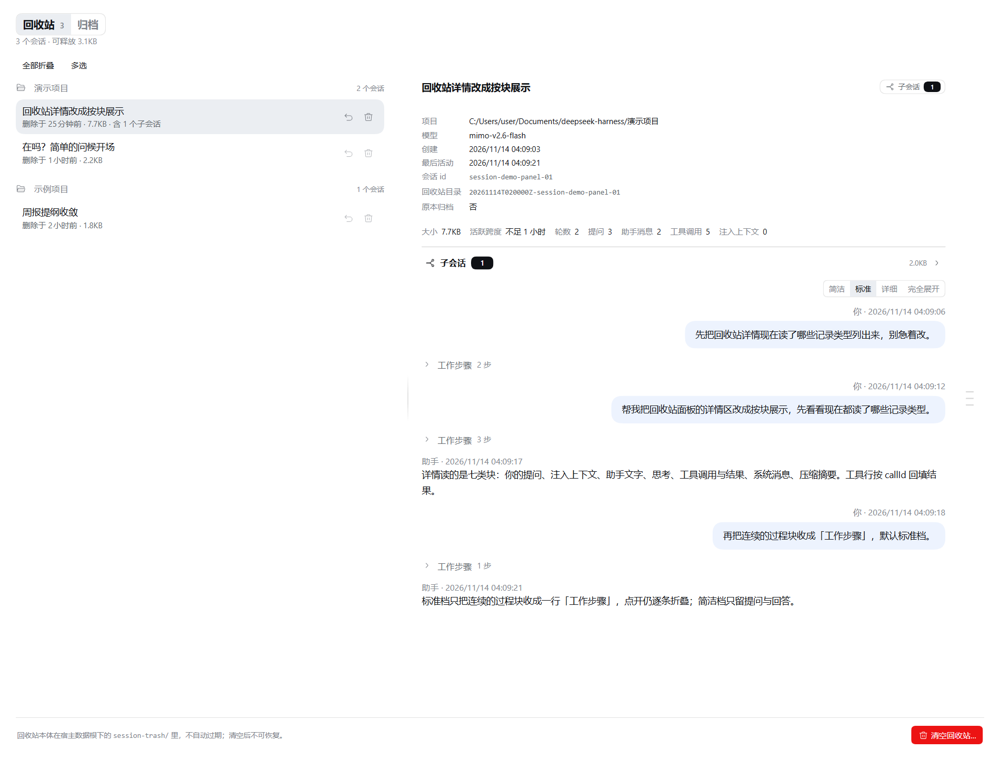
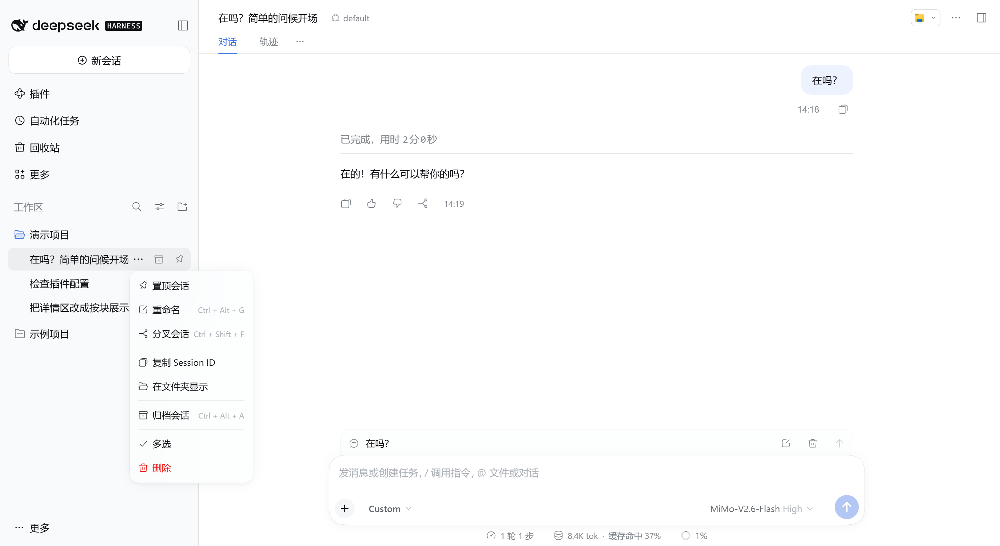
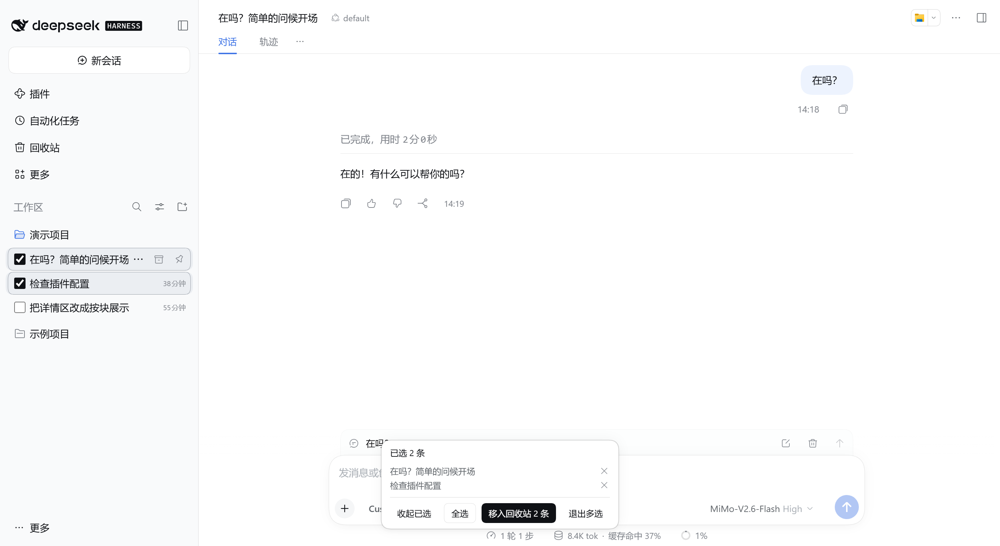

# @xrn1997/dsh-session-delete

[](https://github.com/xrn1997/dsh-session-delete/actions/workflows/ci.yml)
[](https://www.npmjs.com/package/@xrn1997/dsh-session-delete)
[](LICENSE)
[](#兼容性)

> **DeepSeek Harness（DSH）会话回收站插件** —— DSH 原生只有「归档」没有「删除」。本插件补上可恢复的删除：删除即移入本地回收站，随时还原；彻底删除是另一件显式动作。



- 安装：`dsh plugin --profile <profile> add @xrn1997/dsh-session-delete`（装完重启宿主）
- 许可：[Apache-2.0](LICENSE) · 运行环境：`Node.js >= 24` · 兼容性见[下文](#兼容性)
- 数据：回收站留在本机 `$DSH_HOME/session-trash/`（默认 `~/.dsh/session-trash/`），不联网、不上传

## 核心特性

- **删除 = 移入回收站**：会话行「⋯」→「删除」，删完有一条停 6 秒的「撤销」；删掉正打开着的会话时对话随删除关闭，点撤销会重新打开
- **按整组删**：父会话与它的子代理后代一起移入回收站，任一会话在跑就整组拒绝、零副作用（「在新对话中分支」出来的 fork 是独立会话，不受影响）
- **批量操作**：宿主会话列表「⋯」→「多选」一次确认批量移入回收站，成功的 6 秒内可整批撤销；回收站面板里另有「多选」，可批量恢复或批量彻底删除。部分失败不连坐，失败的留在原位可重试
- **回收站面板**：左清单右详情、按项目分组、分栏可拖；「归档」档与回收站平级，已归档会话可只读预览、一步解除归档或删除
- **看得见正文再决定**：详情完整还原对话（提问、助手文字与思考、工具调用与结果、注入上下文），长会话可「加载更早」分页；右缘「提问轨」一点跳到那句提问，子会话收起成摘要条；图片可点开放大，文件给下载控件
- **显式彻底删除**：单条彻底删除与「清空回收站…」都带二次确认，确认框报出这次会释放多少；**永不自动过期**
- **手动维护**：插件设置页的「维护」卡检查并清理三类残留——「孤儿会话」「孤儿附件」「投影缓存」；看过检查结果再决定清不清，不自动扫描、不自动清理
- **可调项有表单**：设置页「可调项」卡直接改三只旋钮，也可以在 profile 的 `cordis.patch.yml` 里改
- **多语言与容错**：界面文案跟随宿主语言（中文 / English，服务不可用时回退内置中文）；宿主不满足条件时插件隐藏全部入口、不影响宿主，失败原文上屏、可重试

## 安装

```bash
dsh plugin --profile <profile> add @xrn1997/dsh-session-delete
```

装完**重启宿主**（Node 半不走热重载）。三种装法任选：

- **npm**（推荐）：使用预构建产物，秒装、无需构建授权
- **GitHub Release**（不依赖 npm 发布，也不需要构建工具链）：`dsh plugin --profile <profile> add https://github.com/xrn1997/dsh-session-delete/releases/latest/download/dsh-session-delete.tgz`；钉版本就把地址换成 `https://github.com/xrn1997/dsh-session-delete/releases/download/V<版本>/xrn1997-dsh-session-delete-<版本>.tgz`。宿主不认 URL 形态的参数时，先把 `.tgz` 下到本地再按离线分发装；Releases 页还没有对应版本时，用 npm 或离线分发
- **离线分发**：`pnpm pack` 出 tarball 后 `dsh plugin --profile <profile> add ./xrn1997-dsh-session-delete-<版本>.tgz`

卸载只移除插件：`dsh plugin --profile <profile> remove @xrn1997/dsh-session-delete`。`$DSH_HOME/session-trash/` 里已有的回收站不会被自动清理。

## 兼容性

- **装得上**：由 `package.json` 的 `engines.dsh` 决定，窗口是 **`>=0.1.7-rc.2 <0.3.0-0`**（预发布版本参与匹配）；不满足的宿主拒绝安装并回滚
- **真跑过**：桌面真机实测名单是 **DSH Desktop 0.2.0-rc.2、0.2.1-rc.1、0.2.1-rc.2、0.2.1-rc.3、0.2.1-rc.5、0.2.2-rc.1、0.2.2-rc.2**；窗口内的其他版本装得上但没实测过，不作为推荐目标
- **多 Peer 部署**：接口的 owner 校验（非 owner 回 403）自 `0.2.1-alpha.3` 起才有；要跑多 Peer，优先选名单里 `0.2.1-rc.1` 起的实测代次

## 使用指南

**删一条**：会话行「⋯」→「删除」。确认框会先说明这一组的规模（「含 N 个子会话，将一起移入回收站」），删完点底部气泡里的「撤销」即恢复。正在运行的会话删不了：菜单里的「删除」置灰（显示「删除（运行中）」或提示先停止）——**列表里看不见的子会话在跑也算**。



**删一批**：「⋯」→「多选」进入批量模式，勾选多条后点浮条里的「移入回收站」一次完成。



**浏览与恢复**：侧栏常驻的「回收站」入口进双栏面板，顶部可切换「回收站 | 归档」两档。左列按项目分组、展开或勾选条目，右侧实时预览正文；点「恢复」送回原项目（原工作区不在了就归入「未分组」），点「彻底删除」或页脚「清空回收站…」永久释放空间——两者共用二次确认。归档档里可一步解除归档；删除归档会话后撤销，回到的是「归档」而不是会话列表。

## 数据存储与安全

| 项目 | 说明 |
| :--- | :--- |
| **本地回收站** | `$DSH_HOME/session-trash/`（默认 `~/.dsh/session-trash/`），与会话目录同卷；搬进搬出是整目录重命名，原子、瞬时 |
| **回收站清单** | 本插件自己的存储域（介质在 `$DSH_HOME/storages/`）；会话文件自带 `id` 与 `cwd`，清单丢了也不影响识别与恢复，读取前会自动与回收站目录对账 |
| **保留期限** | **永不自动过期**，无天数或容量上限；释放空间是显式动作 |
| **附件** | 移入回收站不碰附件；彻底删除只清理仅被这些会话引用的 `.dsh` 内图片副本——共享副本保留、你磁盘上的源文件不受影响；普通文件附件只渲染、不代删 |
| **网络** | 全程本地，不联网、不上传 |

## 可调项

三只旋钮都有默认值，可以在插件设置页的「可调项」卡里改，也可以在 profile 的 `cordis.patch.yml` 里改，都不用改代码：

| 键 | 默认值 | 作用 |
| --- | --- | --- |
| `orphanPreviewLimit` | `200` | 「孤儿附件」预览清单的条数（数量与字节仍按全量报告） |
| `maxAttachmentBytes` | `20971520`（20 MiB） | 附件单次读取的字节上限 |
| `maxJsonRefBytes` | `10485760`（10 MiB） | 附件引用扫描里单个 JSON 引用源的字节上限 |

```yaml
- insert:
    - id: xrn1997-session-delete
      name: '@xrn1997/dsh-session-delete'
      config:
        orphanPreviewLimit: 200
        maxAttachmentBytes: 20971520
        maxJsonRefBytes: 10485760
```

配置在插件激活时归一：未知键、非整数或越界会让这一条激活失败（不会用半套配置启动）。

## 常见问题

**装完侧栏没有「回收站」，会话菜单里也没有「删除」？**
先重启宿主（Node 半不走热重载）。若仍没有，说明这台宿主没通过数据通道探测——插件会主动隐藏全部入口，这是有意的「不可用」表达，不影响宿主稳定性。

**删除会话后，侧栏那一行没有立刻消失？**
插件只在确认宿主列表已真正移除后才移除行；遇到短暂残留，刷新页面即可。

**正在运行的会话为什么删不掉？**
菜单项会置灰（「删除（运行中）」/ 提示先停止）。判据复用宿主自己的运行状态检测，列表里看不见的子会话在跑同样算数；插件不替你终止正在跑的任务，先停止再删。

**批量删除/恢复只成功了一部分？**
执行逐条进行、失败不连坐。失败的留在原位并显示原文，按钮变成「重试这 N 条」；重试只处理失败名单。

**把工作区删了，回收站里的会话还能恢复吗？**
能。恢复照常回盘，只是跳过账本挂接，会话在宿主列表里归入「未分组」；回收站清单里这类条目也归在「未分组」组。

**把会话目录手工搬回 `sessions/` 了，为什么列表里没有？**
手工搬回不是恢复，下一次读清单会把那一行对账掉；请在面板里点「恢复」。

**在局域网 IP 或自定义域名下访问 Web 端，插件入口不出现或提示校验异常？**
插件路由的身份校验托管于宿主：访问用的域名 / IP 要写进宿主 `client-connection` 的 `trustedHosts`，反向代理要保留客户端原始 `Host`，绑定地址用具体 IP 而不是 `0.0.0.0`。附件字节段另有插件的同源取数闸：同站 / 跨站页面与 authority 对不上的 `Origin` / `Referer` 会被拒（403 信封）。身份失效时原文是「需要宿主的 Web 身份」，请求归属不成立时是「非受信来源」。

## 开发与文档

```bash
pnpm install
pnpm gates   # 类型检查 + Lint + 单测 + 构建 + 打包预检
```

更多工程细节：[开发与调试](docs/development.md) · [系统架构](docs/architecture.md) · [界面规格](docs/ui-spec.md) · [更新日志](CHANGELOG.md) · [决策记录](docs/adr/README.md)

## 贡献与许可

欢迎提交 Issue 与 PR，参与前请先阅读 [CONTRIBUTING.md](CONTRIBUTING.md)。

- 主体代码基于 [Apache-2.0](LICENSE) 协议开源。
- 部分 UI 与 Markdown 渲染控件派生自 DeepSeek Harness（MIT 协议），内联第三方依赖许可声明见 [THIRD_PARTY_NOTICES.md](THIRD_PARTY_NOTICES.md)。
